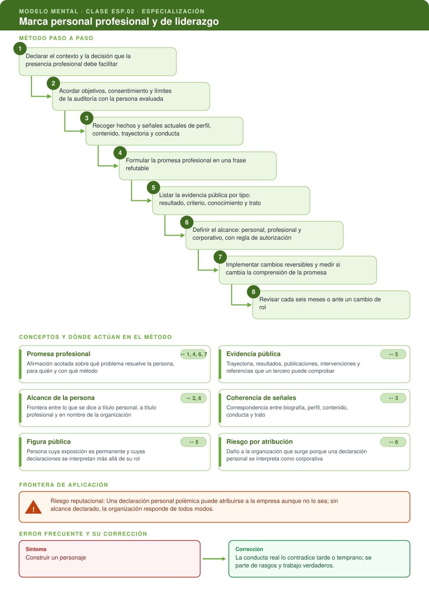

# Clase 02 — Marca personal profesional y de liderazgo

Clase 2 de 10 de la especialización [Reputación, relaciones públicas y comunicación de crisis](README.md). Nivel de dominio: **2 · Aplicación**. Dura unos 150 minutos más el laboratorio asociado. Se cursa después de las partes 06 y 12 del currículo y puede leerse antes de la ampliación de la clase anfitriona 06.11.

[⬅ Anterior](clase-01-identidad-imagen-y-capital-reputacional.md) · [Especialización](README.md) · [Siguiente ➡](clase-03-relaciones-publicas-medios-y-comunicacion-corporativa.md)

## 🎯 Propósito

La marca personal es la reputación de una persona en el contexto de su trabajo: lo que otros pueden repetir sobre qué problema resuelve, para quién y con qué evidencia. No es una pose ni una estética; es un conjunto de señales públicas coherentes con la conducta real. Para empleados y profesionales independientes es un activo de carrera; para ejecutivos y fundadores es además un activo de la organización, porque sus palabras se leen como posición corporativa; para figuras públicas es un territorio de exposición permanente donde la vida privada y la profesional se cruzan. La clase enseña a construirla con evidencia, a delimitarla y a protegerla.

## 🧭 Agenda sugerida (150 minutos)

- **0–20 min.** Lee las definiciones y los siete conceptos; comprueba que puedes explicar cada uno con un ejemplo propio.
- **20–60 min.** Estudia los fundamentos y las distinciones: anota qué afirmación de la clase cambiaría una decisión en tu organización.
- **60–90 min.** Sigue el método paso a paso sobre el ejemplo resuelto, sin mirar la resolución, y compara.
- **90–120 min.** Resuelve los tres casos progresivos y justifica cada decisión con la matriz.
- **120–150 min.** Responde las preguntas de comprobación sin volver al texto y empieza el laboratorio 02.

### Resultados de aprendizaje

- formular una promesa profesional verificable y la evidencia pública que la sostiene.
- diferenciar riesgos de marca personal de empleados, ejecutivos, fundadores y figuras públicas.
- definir qué se habla a título personal, qué requiere autorización y qué se deriva a vocería.
- auditar presencia pública sin juzgar características corporales ni invadir la vida privada.
- redactar un manual de marca personal con límites y mecanismo de revisión.

## 🧠 Modelo mental

El diagrama se construye con el método y los conceptos de esta clase. Las insignias **↔ n** indican en qué pasos se usa el vocabulario de cada concepto. Descripción textual del método:

1. Declarar el contexto y la decisión que la presencia profesional debe facilitar
2. Acordar objetivos, consentimiento y límites de la auditoría con la persona evaluada
3. Recoger hechos y señales actuales de perfil, contenido, trayectoria y conducta
4. Formular la promesa profesional en una frase refutable
5. Listar la evidencia pública por tipo: resultado, criterio, conocimiento y trato
6. Definir el alcance: personal, profesional y corporativo, con regla de autorización
7. Implementar cambios reversibles y medir si cambia la comprensión de la promesa
8. Revisar cada seis meses o ante un cambio de rol

## 🔤 Definiciones

**Definición simple.** Tu marca personal es la respuesta que daría otra persona a la pregunta «¿para qué sirve y en qué se le puede creer?».

**Definición formal.** Marca personal profesional es el conjunto de asociaciones que terceros forman y repiten sobre las competencias, el criterio y la conducta de una persona en un ámbito de trabajo, derivadas de evidencia pública (trayectoria, contenido, trato y resultados) y evaluadas por su coherencia en el tiempo. Su gestión consiste en declarar una promesa, producir evidencia que la respalde, acotar su alcance y revisarla cuando la evidencia cambia.

## 🧩 Conceptos centrales

| Concepto | Definición operacional |
|---|---|
| promesa profesional | afirmación acotada sobre qué problema resuelve la persona, para quién y con qué método |
| evidencia pública | trayectoria, resultados, publicaciones, intervenciones y referencias que un tercero puede comprobar |
| alcance de la persona | frontera entre lo que se dice a título personal, a título profesional y en nombre de la organización |
| coherencia de señales | correspondencia entre biografía, perfil, contenido, conducta y trato |
| figura pública | persona cuya exposición es permanente y cuyas declaraciones se interpretan más allá de su rol |
| riesgo por atribución | daño a la organización que surge porque una declaración personal se interpreta como corporativa |

## 📖 Fundamentos

Construir marca personal no consiste en inventar un personaje, sino en decidir qué parte verdadera del trabajo y del criterio de una persona merece hacerse visible y cómo demostrarla. La promesa debe poder refutarse: «ayudo a pequeñas empresas de servicios a reducir inasistencias con agenda y recordatorios» se puede comprobar con casos; «soy apasionada por la innovación» no. La evidencia convierte la promesa en reputación; sin ella queda como declaración.

La evidencia se acumula con repetición coherente y no con publicaciones esporádicas. Un perfil que cambia de tema cada mes no construye asociación; uno que demuestra en tres o cuatro frentes con ejemplos reales sí. Conviene distinguir cuatro tipos de evidencia: resultados (qué se logró), criterio (cómo se decidió), conocimiento (qué se sabe y se comparte) y trato (cómo se trabaja con otros). Un profesional puede apoyarse en los cuatro; una promesa que sólo descansa en conocimiento se percibe frágil.

Los riesgos cambian con el rol. Un empleado expone sobre todo su criterio y su discreción: publicar información reservada de clientes o hablar mal de colegas se atribuye a su carácter y a su empleador. Un ejecutivo o fundador carga con un riesgo adicional: sus opiniones se leen como posición de la empresa. Una figura pública sostiene una exposición continua donde cualquier comentario antiguo puede reaparecer. Por eso el alcance debe declararse: qué temas se tratan a título personal, cuáles requieren aprobación y cuáles se derivan a una vocería formal.

La imagen profesional incluye comunicación, conducta, voz, postura, vestuario y contexto, pero no autoriza a juzgar rasgos corporales ni a imponer estándares de apariencia ajenos a la función. La auditoría observa hechos y señales (qué dice el perfil, qué respalda la trayectoria, qué ve un cliente en una reunión) y separa observaciones de preferencias. El criterio práctico es: ¿esta señal ayuda a la persona a cumplir la decisión que enfrenta su público, o sólo expresa un gusto del evaluador?

La marca personal también se gestiona hacia atrás. Declaraciones antiguas, fotografías, comentarios y asociaciones pasadas pueden reaparecer. La respuesta correcta no es borrar todo ni fingir que no existió, sino evaluar qué contradice la promesa actual, reconocer lo que cambió si corresponde y eliminar sólo lo que lesiona derechos de terceros o carece de relevancia, sabiendo que lo ya difundido puede estar archivado.

Para organizaciones, el valor de la marca personal de sus ejecutivos es real y vulnerable. Un fundador visible atrae clientes, candidatos e inversionistas, pero su caída arrastra a la empresa. Por eso una política sana separa la persona de la institución: la empresa define criterios de vocería, protege la vida privada de su gente, exige coherencia en lo que se hace a su nombre y prepara a sus líderes para la exposición antes de que ocurra el problema.

### Distinciones que evitan errores

- **Marca personal no es autopromoción.** la autopromoción declara; la marca personal acumula evidencia que terceros repiten
- **Marca personal no es personaje.** se construye con rasgos y trabajo reales; un personaje se rompe cuando la conducta lo contradice
- **Persona pública no es vocero.** el vocero habla con mensajes autorizados; la persona pública habla con su criterio
- **Vida privada no es irrelevante.** puede volverse pública, pero la organización no tiene derecho a invadirla
- **Imagen profesional no es apariencia física.** se evalúan señales funcionales de la tarea, no rasgos corporales

## 🛠️ Método paso a paso

1. declarar el contexto y la decisión que la presencia profesional debe facilitar.
2. acordar objetivos, consentimiento y límites de la auditoría con la persona evaluada.
3. recoger hechos y señales actuales de perfil, contenido, trayectoria y conducta.
4. formular la promesa profesional en una frase refutable.
5. listar la evidencia pública por tipo: resultado, criterio, conocimiento y trato.
6. definir el alcance: personal, profesional y corporativo, con regla de autorización.
7. implementar cambios reversibles y medir si cambia la comprensión de la promesa.
8. revisar cada seis meses o ante un cambio de rol.

## ⚖️ Matriz de decisión

La misma publicación tiene consecuencias distintas según quién la hace y a título de qué.

| Situación | Decisión | Condición que la sostiene | Si falla |
|---|---|---|---|
| Empleado opina sobre su trabajo sin datos reservados | permitir sin autorización | la política de redes lo habilita | se inhibe la conversación legítima |
| Ejecutivo opina sobre un tema regulatorio del sector | pedir revisión previa y aclarar el título | puede leerse como posición corporativa | se genera una crisis de atribución |
| Fundador responde a un ataque personal | derivar a vocería y asesoría antes de responder | hay riesgo jurídico o de escalamiento | una respuesta emocional agrava |
| Figura pública es cuestionada por una declaración antigua | evaluar, reconocer cambio si corresponde, no borrar sin criterio | la declaración está archivada | el borrado se descubre y se ve como encubrimiento |
| Empleado publica información de un cliente | escalar, contener y aplicar procedimiento | hay datos personales o reservados | se agrava por demora |

## 🧮 Ejemplo resuelto

**Enunciado.** La gerente de customer success de Ruta Andina quiere posicionarse como referente en retención para pymes de servicios. Su perfil menciona «liderazgo y pasión por las personas»; tiene dos casos reales documentados de reducción de churn, una charla gremial y ninguna publicación. Su rol incluye hablar con medios sobre incidentes.

**Resolución.**

1. Promesa refutable: «Ayudo a pymes de servicios a reducir cancelaciones con seguimiento de activación en los primeros 30 días».
2. Evidencia disponible: resultados (dos casos), conocimiento (una charla). Faltan criterio y trato publicados. Se planifican dos publicaciones de criterio con datos anonimizados autorizados.
3. Alcance: los temas de retención se publican a título profesional con revisión de Legal sobre cifras; cualquier mención de incidentes se deriva a vocería.
4. Se elimina la frase «pasión por las personas» por no ser refutable y se reemplaza por un resultado específico.
5. Se acuerda revisar el manual a los seis meses y tras cualquier incidente público.

**Resultado.** La marca personal resultante es modesta pero verificable y respeta el límite entre lo personal y lo corporativo. La estrategia evita publicar cifras de clientes sin autorización y prepara a la gerente para no improvisar si se le pregunta por una falla.

## 📈 Casos progresivos

### Caso 1 — nivel básico

**Situación.** Un ejecutivo comercial copia el estilo de un influencer del rubro, con frases motivacionales sin ejemplos propios. Sus clientes dicen que «no se parece a él».

**Decisión razonada.** Se sustituye el personaje por evidencia: dos casos propios, un criterio de decisión y una frase que él mismo diría en una reunión. La coherencia entre el perfil y el trato real vale más que la imitación.

### Caso 2 — nivel intermedio

**Situación.** El fundador de Ruta Andina publica una opinión política en su cuenta personal. Dos clientes preguntan si la empresa comparte esa posición.

**Decisión razonada.** El problema es de alcance. Se publica una aclaración breve de que la opinión es personal, se revisa la política de vocería y se preparan respuestas para clientes. No se censura al fundador ni se silencia, pero se acuerdan criterios de qué temas requieren revisión.

### Caso 3 — nivel avanzado

**Situación.** Una figura pública del rubro es cuestionada por un mensaje de hace ocho años con lenguaje despectivo. Pide ayuda para eliminarlo.

**Decisión razonada.** Se analiza si contradice la promesa actual; si es así, se reconoce públicamente lo que cambió y se pide disculpas específicas si corresponde. Eliminar sin aviso se descubriría y se leería como encubrimiento. Se archiva el contexto y se documenta el aprendizaje.

## 🧯 Riesgos jurídicos, éticos, comerciales y reputacionales

- **Jurídico.** Los datos personales de terceros y de clientes se tratan según la ley de datos personales ([Ley 21.719](https://www.bcn.cl/leychile/navegar?idNorma=1209272), [Ley 19.628](https://www.bcn.cl/leychile/navegar?idNorma=141599)); la relación laboral y la política de redes se subordinan al derecho laboral ([Código del Trabajo](https://www.bcn.cl/leychile/navegar?idNorma=207436)).
- **Ético.** No se pide a una persona adoptar una personalidad ficticia ni se evalúa su cuerpo; la auditoría requiere consentimiento y límites.
- **Comercial.** Depender de un único rostro concentra riesgo; cuando esa persona se va, la empresa pierde la asociación.
- **Reputacional.** Una declaración personal polémica puede atribuirse a la empresa aunque no lo sea; sin alcance declarado, la organización responde de todos modos.

## 🔬 Laboratorio

El laboratorio asociado es [Manual de marca personal y guía de vocería](labs/lab-02-manual-de-marca-personal-y-guia-de-voceria.md). Entrega: Manual de marca personal de dos páginas y guía de vocería con tres preguntas ensayadas y observaciones.

## ✍️ Ejercicios

1. Escribe tu promesa profesional en una frase refutable y lista cuatro piezas de evidencia pública, una por tipo.
2. Toma un perfil público (puede ser sintético) y señala qué afirmaciones carecen de respaldo y cuáles son demostrables.
3. Redacta una política de alcance con tres columnas: a título personal, con autorización y vocería.
4. Analiza una declaración antigua de una figura pública y decide si corresponde reconocer, aclarar o no hacer nada; justifica.
5. Escribe el plan de revisión de una marca personal ante un cambio de rol, con indicadores de comprensión.
6. Identifica qué riesgos de atribución tendría un fundador que publica opiniones sobre competidores.

## ⚠️ Errores habituales

- **Construir un personaje.** La conducta real lo contradice tarde o temprano; se parte de rasgos y trabajo verdaderos.
- **Publicar sin evidencia.** Una promesa sin evidencia es un eslogan; se publican casos, criterio y resultados autorizados.
- **Mezclar personal y corporativo sin declararlo.** Se define el alcance por escrito y se prepara al líder antes de exponerse.
- **Evaluar la apariencia.** Se auditan señales funcionales; no se juzgan rasgos corporales.
- **Borrar sin criterio.** Eliminar lo que otros ya archivaron se interpreta como encubrimiento; se reconoce y se corrige.

## ✅ Evaluación

**Rúbrica.**

| Criterio | Peso | Evidencia de logro |
|---|---|---|
| Promesa y evidencia | 30 % | promesa refutable y evidencia por tipo |
| Alcance y riesgos | 30 % | distingue personal, profesional y corporativo y diferencia por rol |
| Auditoría respetuosa | 20 % | consentimiento, hechos y ausencia de juicios corporales |
| Revisión y límites | 20 % | plan de revisión y manejo de lo antiguo |

**Preguntas de comprobación.**

1. ¿Por qué una promesa profesional debe poder refutarse y qué cuatro tipos de evidencia la sostienen?
2. ¿Qué riesgo adicional enfrenta un ejecutivo o fundador respecto de un empleado en sus publicaciones?
3. ¿Cómo se delimita lo personal, lo profesional y lo corporativo, y qué ocurre si no se declara?
4. ¿Por qué la imagen profesional no autoriza a evaluar rasgos corporales?
5. ¿Qué criterio decide si se reconoce, aclara o elimina una declaración antigua?

## 🇨🇱 Contexto chileno

La norma manda sobre el material pedagógico. Antes de aplicar cualquier recomendación en una operación real, contrasta su texto vigente:

- [Ley 21.719](https://www.bcn.cl/leychile/navegar?idNorma=1209272) — *Regula la protección y el tratamiento de los datos personales y crea la Agencia de Protección de Datos Personales* (Ministerio Secretaría General de la Presidencia): tratamiento de datos personales, bases de licitud y derechos del titular.
- [Ley 19.628](https://www.bcn.cl/leychile/navegar?idNorma=141599) — *Sobre protección de la vida privada* (Ministerio Secretaría General de la Presidencia): régimen previo de datos personales, todavía aplicable en lo no derogado.
- [Código del Trabajo](https://www.bcn.cl/leychile/navegar?idNorma=207436) — *Fija el texto refundido, coordinado y sistematizado del Código del Trabajo* (Ministerio del Trabajo y Previsión Social): deber de protección eficaz de la vida y salud de quienes trabajan.

## 🧭 Síntesis y puente con otras clases

La marca personal funciona cuando la promesa es modesta, verificable y respaldada por trabajo visible, y se vuelve frágil cuando el alcance no se declara. Esta clase se conecta con la vocería (clase 06), porque quien tiene una marca personal fuerte será consultado en momentos difíciles; con la clase 10, porque la política de redes y el trato justo de las personas protegen a la organización sin invadir su vida privada; y con la clase 04, porque el riesgo de atribución es un riesgo de parte interesada. Un buen manual no es un documento de imagen sino un acuerdo sobre qué se promete, qué se demuestra y qué no se dice.

## 📗 Referencias verificables

- Dorie Clark — [*Reinventing You: Define Your Brand, Imagine Your Future*](https://openlibrary.org/isbn/9781422144138) (2013) · ISBN 9781422144138 — **aporta a esta clase:** la marca personal se define con una promesa y se sostiene con evidencia pública repetible por otras personas, y se reposiciona por etapas. **Dónde buscarlo:** las secciones sobre definir la marca personal y construir la reputación. **Acceso:** comprar o biblioteca.
- Michael R. Solomon — [*Consumer Behavior: Buying, Having, and Being*](https://openlibrary.org/isbn/9781292318103) (2019, 13.ª ed.) · ISBN 9781292318103 — **aporta a esta clase:** el consumo como expresión de identidad y pertenencia. **Dónde buscarlo:** los capítulos sobre el yo y el consumo. **Acceso:** comprar o biblioteca.
- Alina Wheeler y Rob Meyerson — [*Designing Brand Identity*](https://openlibrary.org/isbn/9781119984825) (2024, 6.ª ed.) · ISBN 9781119984825 — **aporta a esta clase:** la prueba de aplicación en todos los soportes reales antes de aprobar un sistema. **Dónde buscarlo:** la sección sobre elementos y aplicaciones. **Acceso:** comprar o biblioteca.

> Las obras se citan, no se reproducen. Si la idea no está donde se indica, corresponde reportarlo como error del material. No se citan números de página porque cambian entre ediciones.

[⬅ Anterior](clase-01-identidad-imagen-y-capital-reputacional.md) · [Especialización](README.md) · [Siguiente ➡](clase-03-relaciones-publicas-medios-y-comunicacion-corporativa.md)
