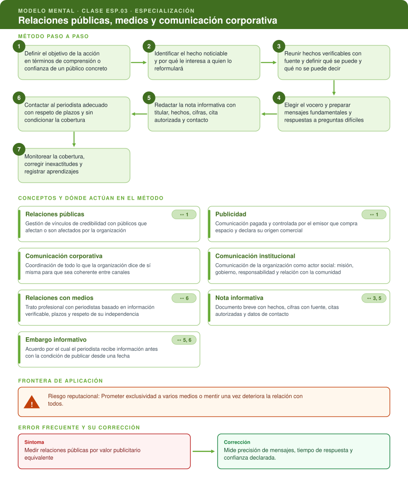

# Clase 03 — Relaciones públicas, medios y comunicación corporativa

Clase 3 de 10 de la especialización [Reputación, relaciones públicas y comunicación de crisis](README.md). Nivel de dominio: **1 · Fundamentos**. Dura unos 150 minutos más el laboratorio asociado. Se cursa después de las partes 06 y 12 del currículo y puede leerse antes de la ampliación de la clase anfitriona 06.12.

[⬅ Anterior](clase-02-marca-personal-profesional-y-de-liderazgo.md) · [Especialización](README.md) · [Siguiente ➡](clase-04-partes-interesadas-asuntos-publicos-y-controversias.md)

## 🎯 Propósito

Las relaciones públicas administran vínculos de confianza entre una organización y los públicos que pueden afectarla o ser afectados por ella; su insumo es la credibilidad y su resultado es la legitimidad para operar. Se diferencian de la publicidad en tres puntos: no controlan el mensaje final porque lo reformulan terceros, no se pagan por espacio sino que se ganan con información de valor y se miden por confianza y comprensión y no sólo por alcance. La comunicación corporativa e institucional ordena lo que la organización dice de sí misma en todos los canales; las relaciones con medios son una de sus herramientas, no su totalidad.

## 🧭 Agenda sugerida (150 minutos)

- **0–20 min.** Lee las definiciones y los siete conceptos; comprueba que puedes explicar cada uno con un ejemplo propio.
- **20–60 min.** Estudia los fundamentos y las distinciones: anota qué afirmación de la clase cambiaría una decisión en tu organización.
- **60–90 min.** Sigue el método paso a paso sobre el ejemplo resuelto, sin mirar la resolución, y compara.
- **90–120 min.** Resuelve los tres casos progresivos y justifica cada decisión con la matriz.
- **120–150 min.** Responde las preguntas de comprobación sin volver al texto y empieza el laboratorio 01.

### Resultados de aprendizaje

- distinguir relaciones públicas, publicidad, comunicación corporativa y relaciones con medios.
- preparar una declaración o nota informativa con hechos verificables y vocero definido.
- diseñar una relación con un periodista basada en información útil y respeto de plazos.
- decidir cuándo conviene proactividad y cuándo conviene esperar.
- evaluar una acción de relaciones públicas con indicadores de credibilidad y no sólo de alcance.

## 🧠 Modelo mental

El diagrama se construye con el método y los conceptos de esta clase. Las insignias **↔ n** indican en qué pasos se usa el vocabulario de cada concepto. Descripción textual del método:

1. Definir el objetivo de la acción en términos de comprensión o confianza de un público concreto
2. Identificar el hecho noticiable y por qué le interesa a quien lo reformulará
3. Reunir hechos verificables con fuente y definir qué se puede y qué no se puede decir
4. Elegir el vocero y preparar mensajes fundamentales y respuestas a preguntas difíciles
5. Redactar la nota informativa con titular, hechos, cifras, cita autorizada y contacto
6. Contactar al periodista adecuado con respeto de plazos y sin condicionar la cobertura
7. Monitorear la cobertura, corregir inexactitudes y registrar aprendizajes

## 🔤 Definiciones

**Definición simple.** Las relaciones públicas consisten en ganar el derecho a ser creídos por personas que no controlas, con hechos y trato, no con espacio comprado.

**Definición formal.** Relaciones públicas es la función de dirección que identifica, establece y mantiene relaciones mutuamente beneficiosas entre una organización y los públicos de los que depende su éxito o fracaso, mediante información verificable, diálogo y conducta consistente, y se evalúa por su efecto sobre la comprensión, la confianza y la legitimidad.

## 🧩 Conceptos centrales

| Concepto | Definición operacional |
|---|---|
| relaciones públicas | gestión de vínculos de credibilidad con públicos que afectan o son afectados por la organización |
| publicidad | comunicación pagada y controlada por el emisor que compra espacio y declara su origen comercial |
| comunicación corporativa | coordinación de todo lo que la organización dice de sí misma para que sea coherente entre canales |
| comunicación institucional | comunicación de la organización como actor social: misión, gobierno, responsabilidad y relación con la comunidad |
| relaciones con medios | trato profesional con periodistas basado en información verificable, plazos y respeto de su independencia |
| nota informativa | documento breve con hechos, cifras con fuente, citas autorizadas y datos de contacto |
| embargo informativo | acuerdo por el cual el periodista recibe información antes con la condición de publicar desde una fecha |

## 📖 Fundamentos

La confusión más frecuente es creer que las relaciones públicas son publicidad con otro nombre. La publicidad compra espacio, controla el mensaje, declara que es comercial y se mide con alcance y respuesta. Las relaciones públicas ganan atención cuando la información interesa a un tercero, no controlan cómo se reformula y se evalúan por credibilidad y comprensión. Esta diferencia tiene consecuencias prácticas: no se «paga» una nota ni se exige aprobar el texto de un periodista, y una organización que lo intenta pierde la relación.

La comunicación corporativa existe para evitar que cada área hable distinto. Sin coordinación, ventas promete una cosa, soporte otra y el sitio una tercera; el público las compara y concluye que la organización no es confiable. Un buen sistema corporativo define mensajes fundamentales, vocerías, canales oficiales y una única fuente de verdad. La comunicación institucional, por su parte, trata a la organización como actor social: cómo se gobierna, qué responsabilidad asume, cómo trata a la comunidad y a sus trabajadores.

La relación con un periodista es una relación profesional, no comercial. El periodista necesita información verificable, plazos realistas, acceso a una persona que pueda responder y la libertad de contrastar con otras fuentes. La organización necesita que su información se entienda con precisión. Se cumple con el plazo, se entregan datos con su fuente, se aclara qué es dicho oficialmente y qué es contexto, se reconoce lo que se ignora y no se condiciona la cobertura. Quien miente o exagera una vez pierde la credibilidad para el resto.

La proactividad y la reactividad tienen costos distintos. Informar proactivamente permite enmarcar un hecho con contexto y evita que otros lo narren, pero crea una expectativa y puede dar visibilidad a algo que habría pasado inadvertido. Responder reactivamente es más seguro, pero cede la iniciativa. La regla práctica: cuando hay personas afectadas, deber de información o certeza de que el hecho se conocerá, se informa primero; cuando el tema es menor y nadie lo ha planteado, se prepara una posición y se espera.

El derecho de aclaración y rectificación protege a las personas y organizaciones frente a informaciones inexactas publicadas por un medio ([Ley 19.733](https://www.bcn.cl/leychile/navegar?idNorma=186049)). Antes de ejercerlo conviene verificar si la inexactitud es sustantiva, si se pidió corrección informal al medio y si el costo de amplificar el tema supera el beneficio de corregirlo. Una rectificación bien fundada es una herramienta; una rectificación ejercida por molestia aumenta la visibilidad de lo que se quería corregir.

Medir relaciones públicas exige indicadores propios. El número de menciones o el valor publicitario equivalente informan volumen, no credibilidad. Son más útiles la proporción de menciones con los mensajes fundamentales correctamente reflejados, la precisión de los hechos publicados, la proporción de consultas de medios respondidas dentro del plazo y la evolución de la confianza declarada en encuestas de los públicos clave. Un buen informe distingue qué logró la acción y qué fue casualidad del ciclo de noticias.

### Distinciones que evitan errores

- **Relaciones públicas no es publicidad.** una se gana con información de valor y se reformula por terceros; la otra se compra y se controla
- **Relaciones públicas no es propaganda.** la propaganda persuade ocultando información o fuente; las relaciones públicas legítimas son transparentes
- **Comunicación corporativa no es marketing.** ordena lo que la organización dice de sí misma ante todos sus públicos, no sólo ante compradores
- **Vocero no es relacionista.** el vocero habla con mensajes autorizados; el relacionista prepara, coordina y mide
- **Corregir no es censurar.** pedir corrección de un hecho inexacto es legítimo; presionar para que no se publique algo verídico no lo es

## 🛠️ Método paso a paso

1. definir el objetivo de la acción en términos de comprensión o confianza de un público concreto.
2. identificar el hecho noticiable y por qué le interesa a quien lo reformulará.
3. reunir hechos verificables con fuente y definir qué se puede y qué no se puede decir.
4. elegir el vocero y preparar mensajes fundamentales y respuestas a preguntas difíciles.
5. redactar la nota informativa con titular, hechos, cifras, cita autorizada y contacto.
6. contactar al periodista adecuado con respeto de plazos y sin condicionar la cobertura.
7. monitorear la cobertura, corregir inexactitudes y registrar aprendizajes.

## ⚖️ Matriz de decisión

La decisión de informar o esperar depende de quién resulta afectado y de si el hecho se conocerá de todas formas.

| Situación | Decisión | Condición que la sostiene | Si falla |
|---|---|---|---|
| Hay personas afectadas por una falla | informar primero con lo confirmado | se puede nombrar qué se hace | terceros narran el hecho |
| Existe deber legal de informar | informar con revisión jurídica | el deber es claro y vigente | se agrega incumplimiento a la falla |
| Un medio consulta por un rumor | responder con hechos verificables y sin especular | hay información confirmada | el silencio se publica como negativa |
| Un medio publica una inexactitud sustantiva | solicitar corrección con evidencia | la inexactitud afecta decisiones | se amplifica el error por reacción desmedida |
| Un tema menor no ha sido planteado | preparar posición y esperar | no hay afectados | se crea una noticia donde no la había |

## 🧮 Ejemplo resuelto

**Enunciado.** Ruta Andina quiere informar que migró a un nuevo proveedor de pagos y que durante el fin de semana habrá demoras en abonos a 300 clientes. Un periodista de un medio especializado pregunta por rumores de una caída. La empresa dispone de la fecha, el plazo máximo de demora y la lista de afectados.

**Resolución.**

1. Hay personas afectadas y plazos conocidos: se informa primero, antes de que el rumor lo narre.
2. Se prepara la nota informativa: qué ocurre, a quién afecta, hasta cuándo, qué hará la empresa y dónde consultar.
3. El vocero será el gerente de operaciones porque conoce el hecho; se evita usar al CEO para un tema operativo.
4. Se contacta primero a los clientes afectados por correo y al periodista el mismo día con la misma información.
5. Se comprueba la cobertura: la nota publicada refleja la fecha y el plazo máximo; si hubiera inexactitud, se pide corrección con la nota original.

**Resultado.** La información que llega al medio y a los clientes es la misma, con hechos y plazos. La organización no pide revisar el texto del periodista ni condiciona su cobertura, y su credibilidad queda intacta para eventos futuros.

## 📈 Casos progresivos

### Caso 1 — nivel básico

**Situación.** Un gerente pide pagar una nota «patrocinada» en un medio para que parezca editorial.

**Decisión razonada.** No es relaciones públicas: es publicidad que oculta su origen. Debe declararse como comercial o no hacerse; ocultarlo expone a sanciones y a pérdida de credibilidad.

### Caso 2 — nivel intermedio

**Situación.** Un medio publica que Ruta Andina «perdió datos de clientes» cuando sólo hubo una demora en reportes. La cifra citada es incorrecta.

**Decisión razonada.** Se solicita corrección con evidencia y se publica una aclaración propia; se evalúa el derecho de aclaración si el medio no corrige y si la inexactitud es sustantiva ([Ley 19.733](https://www.bcn.cl/leychile/navegar?idNorma=186049)). Se evita atacar al periodista.

### Caso 3 — nivel avanzado

**Situación.** Un periodista tiene una filtración interna sobre despidos y llama al gerente de comunicaciones a las 17:50 con plazo a las 19:00.

**Decisión razonada.** Se verifica con Legal y Personas qué es cierto, se informa primero a los trabajadores afectados si corresponde, se prepara una respuesta que no confirme ni niegue sin base y se pide un plazo realista. No se miente ni se hace «off the record» con datos que se podrían filtrar.

## 🧯 Riesgos jurídicos, éticos, comerciales y reputacionales

- **Jurídico.** Las afirmaciones sobre productos o resultados deben tener respaldo ([Ley 19.496](https://www.bcn.cl/leychile/navegar?idNorma=61438)); la rectificación se rige por la ley de libertades de opinión e información ([Ley 19.733](https://www.bcn.cl/leychile/navegar?idNorma=186049)).
- **Ético.** No se pagan notas sin declararlo ni se condiciona la cobertura a ventajas comerciales.
- **Comercial.** Una nota favorable no reemplaza el desempeño del producto; el costo de confundirlas es una promesa que la operación no cumple.
- **Reputacional.** Prometer exclusividad a varios medios o mentir una vez deteriora la relación con todos.

## 🔬 Laboratorio

El laboratorio asociado es [Auditoría reputacional y plan de gestión](labs/lab-01-auditoria-reputacional-y-plan-de-gestion.md). Entrega: Plan de gestión reputacional de una página con tres brechas priorizadas, indicador y responsable por cada una.

## ✍️ Ejercicios

1. Construye una tabla con tres diferencias entre relaciones públicas y publicidad y un ejemplo propio de cada columna.
2. Redacta una nota informativa de 200 palabras sobre un hecho operativo con titular, hechos, cifra con fuente, cita autorizada y contacto.
3. Define los mensajes fundamentales de una organización y comprueba que ningún área contradiga a otra.
4. Decide si informar proactivamente o esperar en tres situaciones y justifica con la matriz de decisión.
5. Redacta una solicitud de corrección a un medio con evidencia y sin tono de reclamo.
6. Diseña tres indicadores de credibilidad que no sean menciones ni valor publicitario equivalente.

## ⚠️ Errores habituales

- **Medir relaciones públicas por valor publicitario equivalente.** Mide precisión de mensajes, tiempo de respuesta y confianza declarada.
- **Pedir aprobar el texto del periodista.** Se ofrece información verificada y se pide corrección de hechos, no control editorial.
- **Mentir «para ganar tiempo».** Se dice lo que se sabe y lo que no; la mentira es una crisis secundaria.
- **Usar al máximo directivo para todo.** Se elige al vocero que conoce el hecho; el CEO se reserva para decisiones de alcance.
- **Confundir comunicación corporativa con marketing.** Alinea mensajes entre todos los públicos, no sólo compradores.

## ✅ Evaluación

**Rúbrica.**

| Criterio | Peso | Evidencia de logro |
|---|---|---|
| Distinción de funciones | 20 % | separa relaciones públicas, publicidad, comunicación corporativa y relaciones con medios |
| Calidad de la nota y los mensajes | 30 % | hechos verificables, fuente, vocero y cita autorizada |
| Decisión proactiva o reactiva | 25 % | aplica la matriz con justificación |
| Medición | 25 % | indicadores de credibilidad con ficha y límite |

**Preguntas de comprobación.**

1. ¿Por qué las relaciones públicas no se miden por valor publicitario equivalente?
2. ¿Cuándo se informa primero y cuándo se prepara posición y se espera?
3. ¿Qué diferencia una solicitud legítima de corrección de un intento de control editorial?
4. ¿Qué papel cumple la comunicación corporativa cuando ventas, soporte y sitio dicen cosas distintas?
5. ¿Qué debe contener una nota informativa para que sea verificable?

## 🇨🇱 Contexto chileno

La norma manda sobre el material pedagógico. Antes de aplicar cualquier recomendación en una operación real, contrasta su texto vigente:

- [Ley 19.733](https://www.bcn.cl/leychile/navegar?idNorma=186049) — *Sobre libertades de opinión e información y ejercicio del periodismo* (Ministerio Secretaría General de Gobierno): libertad de información, derecho de aclaración y rectificación y responsabilidad por abusos.
- [Ley 19.496](https://www.bcn.cl/leychile/navegar?idNorma=61438) — *Establece normas sobre protección de los derechos de los consumidores* (Ministerio de Economía, Fomento y Reconstrucción): derechos del consumidor, publicidad engañosa, información y garantías.

## 🧭 Síntesis y puente con otras clases

Las relaciones públicas no sustituyen a la conducta, la organizan en un relato verificable para quienes no están dentro. La distinción con la publicidad evita errores de presupuesto y de expectativa; la distinción con la comunicación corporativa evita contradicciones entre áreas. Esta clase alimenta la vocería (clase 06), que prepara a quien habla, y la crisis (clases 07 y 08), donde la relación con medios construida en tiempos normales determina cuánta atención recibe la versión de la organización. La credibilidad con un periodista se acumula en los años y se pierde con una declaración inexacta.

## 📗 Referencias verificables

- Charles J. Fombrun — [*Reputation: Realizing Value from the Corporate Image*](https://openlibrary.org/isbn/9780875846330) (1996) · ISBN 9780875846330 — **aporta a esta clase:** la reputación como representación perceptual de las acciones pasadas y las perspectivas de la empresa, comparada con sus rivales ante todos sus públicos clave. **Dónde buscarlo:** los capítulos iniciales sobre qué es la reputación corporativa y por qué crea valor. **Acceso:** comprar o biblioteca.
- Seth Godin — [*This Is Marketing*](https://openlibrary.org/isbn/9780525540830) (2018) · ISBN 9780525540830 — **aporta a esta clase:** el permiso como activo: el derecho a comunicarse con quien espera el mensaje. **Dónde buscarlo:** los capítulos sobre marketing de permiso. **Acceso:** comprar o biblioteca.
- Ann Handley — [*Everybody Writes*](https://openlibrary.org/isbn/9781119854319) (2022, 2.ª ed.) · ISBN 9781119854319 — **aporta a esta clase:** el estándar editorial: verificación de datos, claridad y coherencia de voz. **Dónde buscarlo:** la parte sobre publicación y estándares. **Acceso:** comprar o biblioteca.

> Las obras se citan, no se reproducen. Si la idea no está donde se indica, corresponde reportarlo como error del material. No se citan números de página porque cambian entre ediciones.

[⬅ Anterior](clase-02-marca-personal-profesional-y-de-liderazgo.md) · [Especialización](README.md) · [Siguiente ➡](clase-04-partes-interesadas-asuntos-publicos-y-controversias.md)
