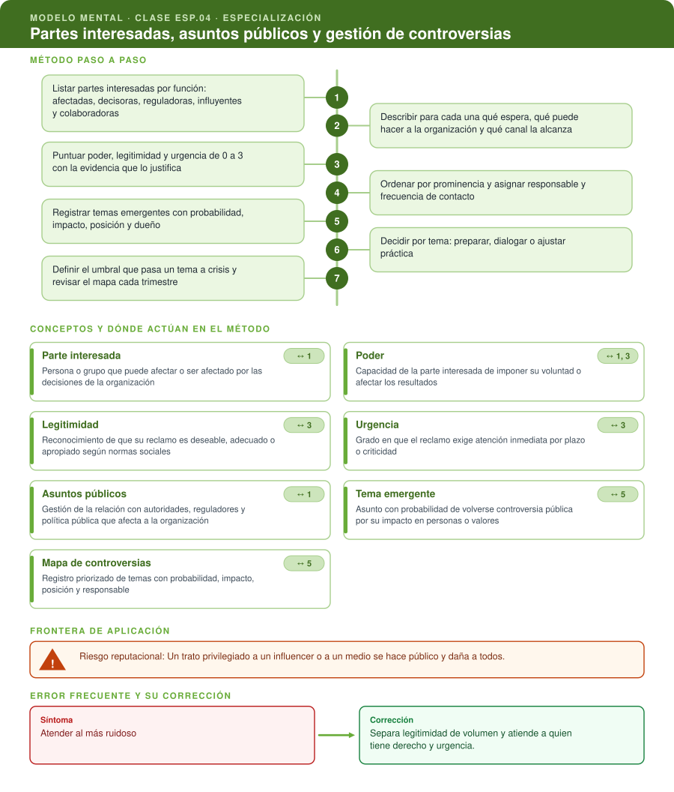

# Clase 04 — Partes interesadas, asuntos públicos y gestión de controversias

Clase 4 de 10 de la especialización [Reputación, relaciones públicas y comunicación de crisis](README.md). Nivel de dominio: **2 · Aplicación**. Dura unos 150 minutos más el laboratorio asociado. Se cursa después de las partes 06 y 12 del currículo y puede leerse antes de la ampliación de la clase anfitriona 23.13.

[⬅ Anterior](clase-03-relaciones-publicas-medios-y-comunicacion-corporativa.md) · [Especialización](README.md) · [Siguiente ➡](clase-05-escucha-social-percepcion-y-alertas.md)

## 🎯 Propósito

Una organización no opera ante un único público sino ante una red de partes interesadas con poderes, derechos y urgencias distintos. Gestionarlas significa identificarlas, priorizarlas con criterio y mantener canales y compromisos documentados. La gestión de asuntos públicos trata la relación con autoridades, reguladores y política pública; la gestión de controversias (issues management) detecta temas emergentes antes de que se conviertan en crisis y decide si prepararse, dialogar o ajustar la práctica. Ambas funciones sólo son legítimas si operan con transparencia.

## 🧭 Agenda sugerida (150 minutos)

- **0–20 min.** Lee las definiciones y los siete conceptos; comprueba que puedes explicar cada uno con un ejemplo propio.
- **20–60 min.** Estudia los fundamentos y las distinciones: anota qué afirmación de la clase cambiaría una decisión en tu organización.
- **60–90 min.** Sigue el método paso a paso sobre el ejemplo resuelto, sin mirar la resolución, y compara.
- **90–120 min.** Resuelve los tres casos progresivos y justifica cada decisión con la matriz.
- **120–150 min.** Responde las preguntas de comprobación sin volver al texto y empieza el laboratorio 03.

### Resultados de aprendizaje

- construir una matriz de partes interesadas priorizada por poder, legitimidad y urgencia.
- distinguir legitimidad de capacidad de hacer ruido.
- identificar temas emergentes y decidir si preparar, dialogar o ajustar práctica.
- explicar qué hace legítima la relación con autoridades y qué la convierte en opacidad.
- definir cuándo una controversia pasa a gestión de crisis.

## 🧠 Modelo mental

El diagrama se construye con el método y los conceptos de esta clase. Las insignias **↔ n** indican en qué pasos se usa el vocabulario de cada concepto. Descripción textual del método:

1. Listar partes interesadas por función: afectadas, decisoras, reguladoras, influyentes y colaboradoras
2. Describir para cada una qué espera, qué puede hacer a la organización y qué canal la alcanza
3. Puntuar poder, legitimidad y urgencia de 0 a 3 con la evidencia que lo justifica
4. Ordenar por prominencia y asignar responsable y frecuencia de contacto
5. Registrar temas emergentes con probabilidad, impacto, posición y dueño
6. Decidir por tema: preparar, dialogar o ajustar práctica
7. Definir el umbral que pasa un tema a crisis y revisar el mapa cada trimestre

## 🔤 Definiciones

**Definición simple.** Las partes interesadas son todas las personas a las que tus decisiones pueden afectar o que pueden afectar tus decisiones; gestionarlas es saber quiénes son, qué esperan y a quién atender primero.

**Definición formal.** Parte interesada es todo individuo o grupo que puede afectar o ser afectado por el logro de los fines de la organización. Su prominencia se determina por la presencia combinada de poder, legitimidad y urgencia. Gestión de controversias es el proceso sistemático de identificar, analizar y priorizar temas emergentes con potencial de afectar a la organización o a sus públicos, y de decidir una posición o una acción antes de que escalen.

## 🧩 Conceptos centrales

| Concepto | Definición operacional |
|---|---|
| parte interesada | persona o grupo que puede afectar o ser afectado por las decisiones de la organización |
| poder | capacidad de la parte interesada de imponer su voluntad o afectar los resultados |
| legitimidad | reconocimiento de que su reclamo es deseable, adecuado o apropiado según normas sociales |
| urgencia | grado en que el reclamo exige atención inmediata por plazo o criticidad |
| asuntos públicos | gestión de la relación con autoridades, reguladores y política pública que afecta a la organización |
| tema emergente | asunto con probabilidad de volverse controversia pública por su impacto en personas o valores |
| mapa de controversias | registro priorizado de temas con probabilidad, impacto, posición y responsable |

## 📖 Fundamentos

La pregunta inicial es quién está en juego. La respuesta habitual incluye clientes, empleados y accionistas, pero omite proveedores, comunidades locales, reguladores, medios, gremios, organizaciones de consumidores y generaciones futuras de clientes. Cada una tiene expectativas distintas y canales distintos. Una matriz que sólo contiene a quienes ya hablan fuerte reproduce el sesgo de atender al más ruidoso.

La prominencia combina tres atributos. Una parte con poder y legitimidad sin urgencia exige atención sostenida pero no inmediata; una con legitimidad y urgencia sin poder (por ejemplo, clientes afectados por una falla) exige respuesta prioritaria por razones éticas aunque no puedan imponer nada; una con poder y urgencia sin legitimidad (un actor que amenaza para obtener ventajas) exige firmeza y prudencia, no concesión. Separar los tres atributos evita tratar igual a quien tiene derecho y a quien sólo hace ruido.

Los asuntos públicos son legítimos cuando son transparentes: la organización declara con quién se reúne, qué propone y a quién representa, documenta la información que entrega y acepta las reglas aplicables a la interacción con autoridades. La influencia oculta, el ofrecimiento de ventajas o la presión indebida no son asuntos públicos sino conductas de riesgo penal y reputacional. Una política sana distingue explicar una posición técnica de intentar obtener un trato privilegiado.

La gestión de controversias parte de una premisa: casi toda crisis fue antes un tema. Un patrón de reclamos, una norma en discusión, una práctica del sector cuestionada o un comentario de un empleado son temas emergentes. El mapa de controversias los registra, estima probabilidad e impacto, define una posición preparada y asigna un dueño. La decisión puede ser preparar y esperar, dialogar con quienes plantean el tema o ajustar la práctica porque el reclamo es justificado.

La decisión de ajustar la práctica es la más importante y la menos usada. Muchas controversias se resuelven corrigiendo lo que el público cuestiona, y ninguna comunicación sustituye ese cambio. Cuando la organización decide no cambiar, debe estar en condiciones de explicar con evidencia por qué, y aceptar que parte del público seguirá en desacuerdo.

El criterio para pasar de controversia a crisis combina tres señales: personas afectadas con perjuicio verificable, aceleración en la conversación pública y daño probable a la continuidad o a la legitimidad. Cuando se cumplen dos de las tres se activa el protocolo de crisis. Ese umbral se define antes, porque durante la presión es difícil acordar si ya se está en crisis.

### Distinciones que evitan errores

- **Parte interesada no es sólo cliente.** incluye a quienes afectan o son afectados aunque no compren
- **Legitimidad no es volumen.** un reclamo con derecho puede ser silencioso y uno ruidoso carecer de fundamento
- **Asuntos públicos no es lobby opaco.** es relación declarada y documentada con autoridades
- **Tema no es crisis.** el tema es potencial; la crisis exige decisiones urgentes con afectados
- **Diálogo no es concesión.** dialogar con quien plantea un reclamo no obliga a aceptarlo

## 🛠️ Método paso a paso

1. listar partes interesadas por función: afectadas, decisoras, reguladoras, influyentes y colaboradoras.
2. describir para cada una qué espera, qué puede hacer a la organización y qué canal la alcanza.
3. puntuar poder, legitimidad y urgencia de 0 a 3 con la evidencia que lo justifica.
4. ordenar por prominencia y asignar responsable y frecuencia de contacto.
5. registrar temas emergentes con probabilidad, impacto, posición y dueño.
6. decidir por tema: preparar, dialogar o ajustar práctica.
7. definir el umbral que pasa un tema a crisis y revisar el mapa cada trimestre.

## ⚖️ Matriz de decisión

El orden de atención surge de combinar atributos, no de quién reclama primero.

| Situación | Decisión | Condición que la sostiene | Si falla |
|---|---|---|---|
| Clientes con perjuicio verificable que no pueden presionar | atender primero | tienen legitimidad y urgencia | se descuida a quienes más afecta la organización |
| Regulador con facultad de fiscalizar | responder con rigor y completitud | el requerimiento es formal | se agrega sanción a la falla |
| Actor con alto alcance y sin hecho verificable | responder sólo con información pública | no hay legitimidad probada | se concede visibilidad y trato privilegiado |
| Empleados que se enteran por medios | informar antes o a la par | hay decisión que los afecta | se rompe confianza interna |
| Tema emergente con impacto probable en consumidores | ajustar práctica o dialogar antes | el reclamo es fundado | se convierte en crisis pública |

## 🧮 Ejemplo resuelto

**Enunciado.** Ruta Andina detecta un incidente de datos que expone nombres y correos de 1.200 clientes. Debe priorizar a cinco partes interesadas: clientes afectados, regulador de datos, medio local, empleados e influencer del rubro con 200 mil seguidores. Tiene dos horas antes de que una nota se publique.

**Resolución.**

1. Clientes afectados: poder bajo (1), legitimidad alta (3), urgencia alta (3). Prominencia máxima por derecho y daño.
2. Regulador: poder alto (3), legitimidad alta (3), urgencia media (2). Se atiende con completitud y respaldo documental.
3. Medio local: poder medio (2), legitimidad media (2), urgencia alta por plazo (3). Se atiende con la declaración aprobada.
4. Empleados: poder medio (2), legitimidad alta (3), urgencia media (2). Se informa a la par para que no se enteren por la prensa.
5. Influencer: poder alto en alcance (3), legitimidad baja sin hecho propio (1), urgencia baja (1). Se atiende con la información pública.

**Resultado.** Orden de contacto: clientes y regulador, empleados y medio, influencer. El trato privilegiado al influencer sería un error, porque su alcance no implica legitimidad; todos reciben el mismo texto y ninguno recibe ventajas.

## 📈 Casos progresivos

### Caso 1 — nivel básico

**Situación.** Un gerente quiere atender sólo a los clientes que más facturan durante una falla general.

**Decisión razonada.** Los clientes afectados deben atenderse por perjuicio y derecho, no por facturación. Se puede coordinar un contacto especial para cuentas críticas sin retrasar al resto.

### Caso 2 — nivel intermedio

**Situación.** Se discute una norma que afectaría el modelo de cobro de Ruta Andina. La empresa quiere reunirse con autoridades.

**Decisión razonada.** Se registra la reunión, se explica la posición técnica con datos, se declara a quién se representa y se acepta la regla de transparencia. No se ofrecen ventajas ni se presiona.

### Caso 3 — nivel avanzado

**Situación.** Aparece en foros un tema: «la empresa dificulta la salida de clientes». Hay tres reclamos fundados y una cuenta con 80 mil seguidores lo amplifica.

**Decisión razonada.** El tema pasa de emergente a crisis si los reclamos son fundados y se acelera. Se decide ajustar la práctica (simplificar la baja), dialogar con los afectados y publicar el cambio. Defender la práctica sin cambiarla sería comunicar sin corregir.

## 🧯 Riesgos jurídicos, éticos, comerciales y reputacionales

- **Jurídico.** La relación con autoridades puede tener consecuencias penales si se ofrecen ventajas indebidas; el modelo de prevención de delitos de la organización debe cubrirla ([Ley 20.393](https://www.bcn.cl/leychile/navegar?idNorma=1008668)). Los datos de las partes interesadas se protegen ([Ley 21.719](https://www.bcn.cl/leychile/navegar?idNorma=1209272)).
- **Ético.** No se usan datos de las personas para perfilarlas sin base ni se aplica un trato distinto a quien reclama con derecho.
- **Comercial.** Priorizar sólo por facturación puede dañar a quienes tienen mayor derecho; priorizar sólo por ruido distorsiona el presupuesto.
- **Reputacional.** Un trato privilegiado a un influencer o a un medio se hace público y daña a todos.

## 🔬 Laboratorio

El laboratorio asociado es [Matriz de partes interesadas y mapa de controversias](labs/lab-03-matriz-de-partes-interesadas-y-mapa-de-controversias.md). Entrega: Matriz completa con prioridades justificadas y mapa de cinco temas con decisión y responsable.

## ✍️ Ejercicios

1. Construye una matriz con ocho partes interesadas de una organización y puntúa poder, legitimidad y urgencia con evidencia.
2. Explica con un ejemplo una parte con legitimidad y urgencia pero sin poder y qué trato merece.
3. Define cinco reglas de transparencia para relaciones con autoridades.
4. Redacta un mapa de cinco temas emergentes con probabilidad, impacto, posición y dueño.
5. Define el umbral que convierte un tema en crisis y justifica cada señal.
6. Decide entre preparar, dialogar o ajustar práctica en tres temas y justifica con evidencia.

## ⚠️ Errores habituales

- **Atender al más ruidoso.** Separa legitimidad de volumen y atiende a quien tiene derecho y urgencia.
- **Descartar a quien no compra.** Incluye a comunidades, reguladores y empleados como partes con efectos reales.
- **Operar asuntos públicos sin registro.** Documenta reuniones, posiciones y representados.
- **Esperar a que el tema sea crisis.** Registra temas emergentes y decide ajustar práctica a tiempo.
- **Dialogar sin intención de escuchar.** Si el reclamo es fundado, se ajusta la práctica; si no, se explica con evidencia.

## ✅ Evaluación

**Rúbrica.**

| Criterio | Peso | Evidencia de logro |
|---|---|---|
| Identificación y puntuación | 30 % | partes completas y puntajes con evidencia |
| Criterio de prioridad | 25 % | separa legitimidad de ruido y orden coherente |
| Mapa de controversias | 25 % | temas con probabilidad, impacto, posición y dueño |
| Transparencia y umbral | 20 % | reglas de relación con autoridades y umbral de crisis |

**Preguntas de comprobación.**

1. ¿Qué tres atributos determinan la prominencia de una parte interesada y por qué se separan?
2. ¿Por qué no se prioriza sólo por facturación o por volumen de ruido?
3. ¿Qué distingue asuntos públicos legítimos de influencia opaca?
4. ¿Qué decisiones pueden tomarse frente a un tema emergente?
5. ¿Con qué señales se decide que un tema pasa a crisis?

## 🇨🇱 Contexto chileno

La norma manda sobre el material pedagógico. Antes de aplicar cualquier recomendación en una operación real, contrasta su texto vigente:

- [Ley 20.393](https://www.bcn.cl/leychile/navegar?idNorma=1008668) — *Establece la responsabilidad penal de las personas jurídicas* (Ministerio Secretaría General de la Presidencia): modelo de prevención de delitos y responsabilidad penal de la persona jurídica.
- [Ley 21.719](https://www.bcn.cl/leychile/navegar?idNorma=1209272) — *Regula la protección y el tratamiento de los datos personales y crea la Agencia de Protección de Datos Personales* (Ministerio Secretaría General de la Presidencia): tratamiento de datos personales, bases de licitud y derechos del titular.

## 🧭 Síntesis y puente con otras clases

Las partes interesadas dan el mapa de quién importa, y las controversias dan el calendario de qué importará pronto. Este trabajo ordena las decisiones de las clases siguientes: la escucha (clase 05) alimenta el mapa de temas emergentes, la vocería (clase 06) define quién habla con cada parte, y el protocolo de crisis (clase 07) usa el umbral que aquí se fija. La lección práctica es que la prioridad no la fija el ruido sino el derecho y la urgencia, y que ajustar la práctica cuando el reclamo es fundado es la mejor comunicación disponible.

## 📗 Referencias verificables

- Ronald K. Mitchell, Bradley R. Agle y Donna J. Wood — [*Toward a Theory of Stakeholder Identification and Salience (Academy of Management Review)*](https://doi.org/10.5465/amr.1997.9711022105) (1997) · DOI 10.5465/amr.1997.9711022105 — **aporta a esta clase:** una parte interesada es más prominente cuanto más poder, legitimidad y urgencia reúne, y su clase determina la atención que merece. **Dónde buscarlo:** la sección sobre la tipología de atributos y clases de partes interesadas. **Acceso:** acceso limitado.
- W. Timothy Coombs — [*Ongoing Crisis Communication: Planning, Managing, and Responding*](https://openlibrary.org/isbn/9781544331959) (2019, 5.ª ed.) · ISBN 9781544331959 — **aporta a esta clase:** la gestión de crisis se ordena en prevención y preparación, respuesta y revisión posterior, con instrucción primero a las víctimas y luego a la reputación. **Dónde buscarlo:** los capítulos sobre el ciclo de la crisis y la respuesta inicial. **Acceso:** comprar o biblioteca.
- Robert S. Kaplan y David P. Norton — [*The Balanced Scorecard*](https://openlibrary.org/isbn/9780875846514) (1996) · ISBN 9780875846514 — **aporta a esta clase:** las cuatro perspectivas: financiera, cliente, procesos y aprendizaje. **Dónde buscarlo:** los capítulos que presentan el cuadro de mando. **Acceso:** comprar o biblioteca.

> Las obras se citan, no se reproducen. Si la idea no está donde se indica, corresponde reportarlo como error del material. No se citan números de página porque cambian entre ediciones.

[⬅ Anterior](clase-03-relaciones-publicas-medios-y-comunicacion-corporativa.md) · [Especialización](README.md) · [Siguiente ➡](clase-05-escucha-social-percepcion-y-alertas.md)
