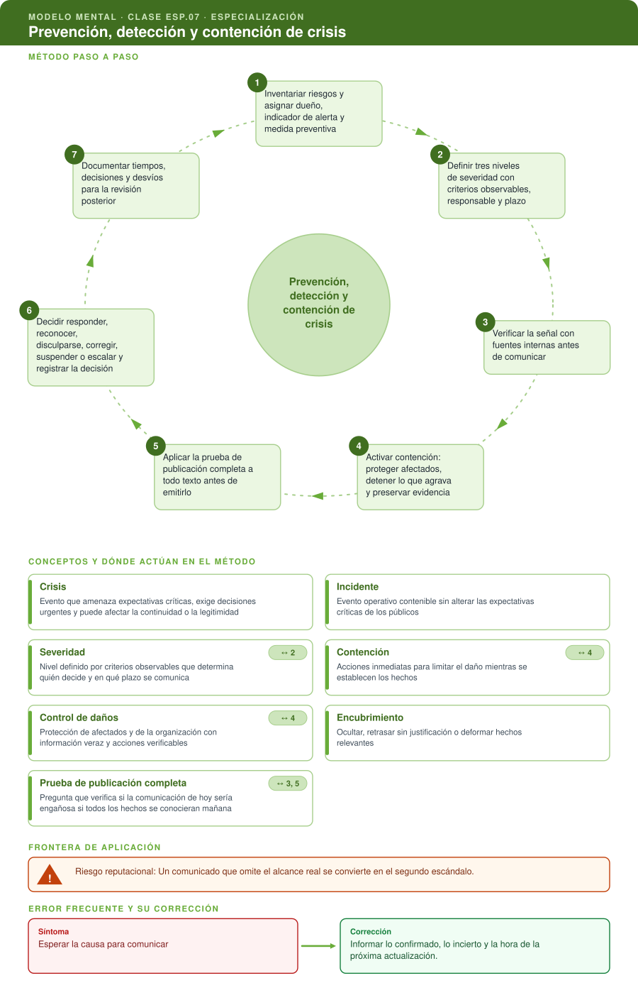

# Clase 07 — Prevención, detección y contención de crisis

Clase 7 de 10 de la especialización [Reputación, relaciones públicas y comunicación de crisis](README.md). Nivel de dominio: **3 · Respuesta**. Dura unos 150 minutos más el laboratorio asociado. Se cursa después de las partes 06 y 12 del currículo y puede leerse antes de la ampliación de la clase anfitriona 06.10.

[⬅ Anterior](clase-06-voceria-entrevistas-y-preguntas-dificiles.md) · [Especialización](README.md) · [Siguiente ➡](clase-08-respuesta-reparacion-y-recuperacion-de-confianza.md)

## 🎯 Propósito

Una crisis es un evento que amenaza expectativas importantes de los públicos, exige decisiones en plazos cortos y puede afectar la continuidad o la legitimidad de la organización. La mayor parte del trabajo ocurre antes: identificar riesgos, asignar dueños, entrenar y definir niveles de severidad con criterios observables. La detección usa las señales de escucha y las operativas; la contención limita el daño inmediato a las personas afectadas y a la organización mientras se establecen los hechos. Control de daños no es encubrimiento: se protege primero a quien puede resultar dañado y se comunica lo confirmado, lo incierto y lo que se hará.

## 🧭 Agenda sugerida (150 minutos)

- **0–20 min.** Lee las definiciones y los siete conceptos; comprueba que puedes explicar cada uno con un ejemplo propio.
- **20–60 min.** Estudia los fundamentos y las distinciones: anota qué afirmación de la clase cambiaría una decisión en tu organización.
- **60–90 min.** Sigue el método paso a paso sobre el ejemplo resuelto, sin mirar la resolución, y compara.
- **90–120 min.** Resuelve los tres casos progresivos y justifica cada decisión con la matriz.
- **120–150 min.** Responde las preguntas de comprobación sin volver al texto y empieza el laboratorio 05.

### Resultados de aprendizaje

- distinguir prevención, detección, contención, respuesta, corrección, recuperación y aprendizaje.
- clasificar tipos de crisis y atribuir responsabilidad con evidencia.
- definir niveles de severidad con criterios observables y un responsable por nivel.
- aplicar la prueba de publicación completa para separar control de daños de encubrimiento.
- decidir cuándo responder, reconocer, disculparse, corregir, suspender publicaciones o escalar.

## 🧠 Modelo mental

El diagrama se construye con el método y los conceptos de esta clase. Las insignias **↔ n** indican en qué pasos se usa el vocabulario de cada concepto. Descripción textual del método:

1. Inventariar riesgos y asignar dueño, indicador de alerta y medida preventiva
2. Definir tres niveles de severidad con criterios observables, responsable y plazo
3. Verificar la señal con fuentes internas antes de comunicar
4. Activar contención: proteger afectados, detener lo que agrava y preservar evidencia
5. Aplicar la prueba de publicación completa a todo texto antes de emitirlo
6. Decidir responder, reconocer, disculparse, corregir, suspender o escalar y registrar la decisión
7. Documentar tiempos, decisiones y desvíos para la revisión posterior

## 🔤 Definiciones

**Definición simple.** Una crisis es un problema que no puede esperar y que, si se maneja mal, daña la confianza; prevenir es evitar que ocurra y contener es evitar que crezca.

**Definición formal.** Gestión de crisis es el conjunto de funciones que reducen la probabilidad de eventos que amenazan expectativas críticas de los públicos, permiten detectarlos y evaluarlos con prontitud, limitan el daño a las personas y a la organización y establecen una respuesta proporcional, verificable y coordinada, con revisión posterior que modifica el sistema.

## 🧩 Conceptos centrales

| Concepto | Definición operacional |
|---|---|
| crisis | evento que amenaza expectativas críticas, exige decisiones urgentes y puede afectar la continuidad o la legitimidad |
| incidente | evento operativo contenible sin alterar las expectativas críticas de los públicos |
| severidad | nivel definido por criterios observables que determina quién decide y en qué plazo se comunica |
| contención | acciones inmediatas para limitar el daño mientras se establecen los hechos |
| control de daños | protección de afectados y de la organización con información veraz y acciones verificables |
| encubrimiento | ocultar, retrasar sin justificación o deformar hechos relevantes |
| prueba de publicación completa | pregunta que verifica si la comunicación de hoy sería engañosa si todos los hechos se conocieran mañana |

## 📖 Fundamentos

Siete fases ordenan el trabajo y evitan que la organización sólo entrene la respuesta: prevención (reducir la probabilidad), detección (ver a tiempo), contención (limitar el daño), respuesta (decir y hacer lo necesario), corrección (arreglar la causa), recuperación (recomponer la confianza con evidencia) y aprendizaje (cambiar el sistema). Cada fase tiene dueño, indicador y entregable. La prevención es la más barata y la menos visible, por lo que suele financiarse mal; la recuperación es la más larga y la que se declara cerrada antes de tiempo.

No todo incidente es una crisis. La diferencia se define con criterios observables y no con intuición: personas afectadas con perjuicio verificable, aceleración de la conversación pública, afectación de datos, seguridad o salud, interés de autoridades o medios y riesgo para la continuidad. Un protocolo sano fija tres niveles —por ejemplo, incidente, crisis y crisis mayor— con un responsable, un plazo de primera comunicación y un criterio de escalamiento para cada uno. Sin niveles, toda alerta se discute desde cero.

El tipo de crisis condiciona la respuesta. Cuando el público atribuye alta responsabilidad a la organización (error propio, negligencia, decisión deliberada), la respuesta exige reconocimiento y reparación. Cuando la atribución es moderada (accidente, falla de un tercero con responsabilidad compartida), corresponde información, cuidado de afectados y explicación de la corrección. Cuando la atribución es baja (rumor, desinformación, manipulación), corresponde corregir con evidencia sin aceptar responsabilidad que no existe. Aplicar el patrón equivocado produce disculpas innecesarias o defensas ofensivas.

Ante cualquier crisis hay una prioridad ordenada: primero, la protección de las personas afectadas con instrucciones claras de qué hacer; segundo, la información veraz que les permite decidir; tercero, la protección de la reputación de la organización. Invertir el orden —defender la imagen antes de ayudar a los afectados— es el error más grave, y se percibe de inmediato.

El control de daños se diferencia del encubrimiento con una prueba simple: si toda la información relevante se publicara mañana, ¿la comunicación de hoy resultaría engañosa por acción u omisión? Si la respuesta es sí, ya no es control de daños. Se pueden retener datos que comprometan investigaciones, la privacidad de personas o secretos legítimos, pero eso se declara: «aún no podemos informar X por Y». Callar sin explicarlo es indistinguible del ocultamiento.

La decisión de qué hacer sigue una guía. Se responde cuando hay personas afectadas, la fuente es verificable y el alcance puede crecer. Se reconoce un error cuando la evidencia interna lo confirma. Se piden disculpas cuando la organización causó el daño y puede nombrar qué hará distinto. Se corrige cuando circula información falsa que afecta decisiones. Se suspenden publicaciones cuando el calendario contradice la experiencia de los afectados. Se escala cuando el hecho supera la autoridad, el conocimiento o el riesgo jurídico de quien decide. Estas seis decisiones no son excluyentes; se combinan con criterio y quedan registradas.

### Distinciones que evitan errores

- **Incidente no es crisis.** el incidente no altera expectativas críticas; la crisis sí y exige decisiones urgentes
- **Control de daños no es encubrimiento.** el primero protege y comunica con veracidad; el segundo oculta o deforma
- **Contención no es respuesta.** contener limita el daño inmediato; responder informa y compromete acciones
- **Disculpa no es reconocimiento.** reconocer afirma el hecho; disculparse asume el daño y compromete conducta
- **Silencio no es neutralidad.** no hablar es una decisión con efectos y debe justificarse

## 🛠️ Método paso a paso

1. inventariar riesgos y asignar dueño, indicador de alerta y medida preventiva.
2. definir tres niveles de severidad con criterios observables, responsable y plazo.
3. verificar la señal con fuentes internas antes de comunicar.
4. activar contención: proteger afectados, detener lo que agrava y preservar evidencia.
5. aplicar la prueba de publicación completa a todo texto antes de emitirlo.
6. decidir responder, reconocer, disculparse, corregir, suspender o escalar y registrar la decisión.
7. documentar tiempos, decisiones y desvíos para la revisión posterior.

## ⚖️ Matriz de decisión

Estas seis decisiones se toman con evidencia y se registran. La condición que las sostiene es lo que se verifica.

| Situación | Decisión | Condición que la sostiene | Si falla |
|---|---|---|---|
| Hay personas afectadas y la fuente es verificable | responder con lo confirmado | se puede decir qué se hace | se pierde la iniciativa y otros narran |
| La evidencia interna confirma el error | reconocer el error | los hechos son claros | se agrega pérdida de integridad |
| La organización causó el daño y puede cambiar conducta | pedir disculpas específicas | hay acción verificable asociada | la disculpa se lee como táctica |
| Circula información falsa que afecta decisiones | corregir con evidencia | existe prueba que la refuta | se amplifica el falso |
| El calendario contradice la experiencia de los afectados | suspender publicaciones | la falla está activa | la campaña agrava la percepción |
| El hecho supera autoridad o riesgo jurídico | escalar a dirección y asesoría | hay riesgo legal, daño relevante o duda | se decide sin el nivel adecuado |

## 🧮 Ejemplo resuelto

**Enunciado.** Ruta Andina detecta que una actualización duplicó citas en 80 cuentas durante 36 horas. Hay 12 reclamos públicos, una campaña promocional programada para mañana y una causa desconocida. Producto sugiere esperar a conocer la causa para comunicar.

**Resolución.**

1. Clasificación: hay personas afectadas, conversación pública y daño a la operación de clientes. Es una crisis de nivel 2 (afectación a clientes con causa interna probable).
2. Contención: revertir el cambio, preservar registros, corregir agendas afectadas y suspender la campaña programada.
3. Prueba de publicación completa: decir «estamos investigando» sin detallar la duplicación sería engañoso por omisión; se informa el hecho, el alcance conocido y el plazo.
4. Decisiones: responder (hay afectados y fuente verificable), reconocer el fallo (evidencia interna), no disculparse aún por la causa que se ignora pero sí por las molestias causadas, suspender publicaciones y escalar el criterio de compensación a dirección.
5. Se fija una comunicación a las 18:00 y otra tras confirmar la causa; el registro de decisiones se guarda para la revisión posterior.

**Resultado.** La respuesta ocurre en menos de dos horas con lo confirmado, no promete la causa ni atribuye culpa a terceros y detiene la campaña. Esperar a conocer la causa habría dejado a los afectados enterarse por redes y habría convertido un fallo en una crisis de confianza.

## 📈 Casos progresivos

### Caso 1 — nivel básico

**Situación.** Un empleado de soporte detecta que tres clientes recibieron una factura con montos erróneos. No hay protocolo.

**Decisión razonada.** Es un incidente. Se corrige, se avisa a los afectados con un mensaje simple y se revisa por qué ocurrió. Se registra para aprendizaje. Escalar a crisis sería desproporcionado, y no registrar impediría detectar un patrón.

### Caso 2 — nivel intermedio

**Situación.** Una cuenta con 20 mil seguidores publica que el servicio filtra datos. No hay evidencia, pero hay cuarenta compartidos.

**Decisión razonada.** Se verifica internamente. Si no hay filtración, se corrige con evidencia y sin atacar a la cuenta; si la hay, se activa el protocolo de datos y se informa a los afectados. Responder antes de verificar puede desmentir algo cierto.

### Caso 3 — nivel avanzado

**Situación.** La gerencia sabe de una falla de seguridad desde hace tres semanas y propone no informar porque «no hay evidencia de uso malicioso».

**Decisión razonada.** La prueba de publicación completa falla: informar tarde por conveniencia se interpretaría como encubrimiento. Se escala a dirección y asesoría jurídica, se informa a los afectados con lo que se sabe y se corrige el proceso de decisión que permitió la demora.

## 🧯 Riesgos jurídicos, éticos, comerciales y reputacionales

- **Jurídico.** Los deberes de informar en caso de vulneración de datos y los derechos del consumidor son exigibles ([Ley 21.719](https://www.bcn.cl/leychile/navegar?idNorma=1209272), [Ley 19.496](https://www.bcn.cl/leychile/navegar?idNorma=61438)); la persona jurídica puede responder por deficiencias en la prevención de delitos ([Ley 20.393](https://www.bcn.cl/leychile/navegar?idNorma=1008668)).
- **Ético.** No se retiene información que impida a las personas protegerse; la protección de afectados precede a la de la imagen.
- **Comercial.** Suspender campañas y compensar tiene costo; el costo de no hacerlo es mayor si agrava la crisis.
- **Reputacional.** Un comunicado que omite el alcance real se convierte en el segundo escándalo.

## 🔬 Laboratorio

El laboratorio asociado es [Protocolo de crisis y plantillas de declaración](labs/lab-05-protocolo-de-crisis-y-plantillas-de-declaracion.md). Entrega: Protocolo aprobado de tres niveles, declaración adaptada y revisión posterior de la simulación.

## ✍️ Ejercicios

1. Define tres niveles de severidad con criterios observables, responsable y plazo de primera comunicación.
2. Aplica la prueba de publicación completa a tres textos de declaraciones y reescribe los que fallen.
3. Clasifica cinco situaciones sintéticas como incidente o crisis y justifica.
4. Para una falla de producto, decide: responder, reconocer, disculparse, corregir, suspender o escalar, con evidencia.
5. Redacta el registro de decisiones de las tres primeras horas de una crisis simulada.
6. Distingue un caso de control de daños legítimo de uno de encubrimiento con un criterio verificable.

## ⚠️ Errores habituales

- **Esperar la causa para comunicar.** Informar lo confirmado, lo incierto y la hora de la próxima actualización.
- **Defender la imagen antes de proteger a los afectados.** Primero instrucciones y protección; luego reputación.
- **No definir niveles.** Sin niveles, cada alerta se discute desde cero y se pierde tiempo.
- **Culpar a un tercero sin evidencia.** Atribuir sólo con prueba; la responsabilidad frente al cliente es de la organización.
- **Declarar cerrada la crisis sin evidencia de corrección.** Cerrar cuando la medida correctiva y la actualización tienen evidencia.

## ✅ Evaluación

**Rúbrica.**

| Criterio | Peso | Evidencia de logro |
|---|---|---|
| Clasificación y niveles | 25 % | criterios observables y responsable por nivel |
| Control de daños versus encubrimiento | 30 % | aplica la prueba de publicación completa |
| Seis decisiones | 30 % | decide con evidencia y registra |
| Registro y aprendizaje | 15 % | documenta tiempos y desvíos |

**Preguntas de comprobación.**

1. ¿Cuáles son las siete fases y por qué la mayoría de las organizaciones sólo entrenan una?
2. ¿Cómo se distingue un incidente de una crisis con criterios observables?
3. ¿Qué pregunta distingue control de daños de encubrimiento?
4. ¿En qué orden se protege a afectados, se informa y se cuida la reputación?
5. ¿Cuándo corresponde suspender publicaciones y cuándo escalar?

## 🇨🇱 Contexto chileno

La norma manda sobre el material pedagógico. Antes de aplicar cualquier recomendación en una operación real, contrasta su texto vigente:

- [Ley 21.719](https://www.bcn.cl/leychile/navegar?idNorma=1209272) — *Regula la protección y el tratamiento de los datos personales y crea la Agencia de Protección de Datos Personales* (Ministerio Secretaría General de la Presidencia): tratamiento de datos personales, bases de licitud y derechos del titular.
- [Ley 19.496](https://www.bcn.cl/leychile/navegar?idNorma=61438) — *Establece normas sobre protección de los derechos de los consumidores* (Ministerio de Economía, Fomento y Reconstrucción): derechos del consumidor, publicidad engañosa, información y garantías.
- [Ley 20.393](https://www.bcn.cl/leychile/navegar?idNorma=1008668) — *Establece la responsabilidad penal de las personas jurídicas* (Ministerio Secretaría General de la Presidencia): modelo de prevención de delitos y responsabilidad penal de la persona jurídica.

## 🧭 Síntesis y puente con otras clases

Prevenir, detectar y contener ocupan la mayor parte del trabajo y la menor parte de la atención. Esta clase fija el marco de decisión de seis acciones —responder, reconocer, disculparse, corregir, suspender y escalar— y la prueba de publicación completa que separa el control de daños del encubrimiento. Sirve de base para la clase 08, que trata la reparación, y para la clase 09, que trata los casos en que la amenaza es una falsedad. Los ocho escenarios de la especialización son el lugar para practicar estas decisiones con alternativas y consecuencias.

## 📗 Referencias verificables

- W. Timothy Coombs — [*Ongoing Crisis Communication: Planning, Managing, and Responding*](https://openlibrary.org/isbn/9781544331959) (2019, 5.ª ed.) · ISBN 9781544331959 — **aporta a esta clase:** la respuesta de crisis se ajusta a cuánta responsabilidad el público atribuye a la organización según el tipo de crisis, su historial y su reputación previa. **Dónde buscarlo:** los capítulos sobre la teoría situacional de comunicación de crisis y la selección de estrategias de respuesta. **Acceso:** comprar o biblioteca.
- W. Timothy Coombs — [*Ongoing Crisis Communication: Planning, Managing, and Responding*](https://openlibrary.org/isbn/9781544331959) (2019, 5.ª ed.) · ISBN 9781544331959 — **aporta a esta clase:** la gestión de crisis se ordena en prevención y preparación, respuesta y revisión posterior, con instrucción primero a las víctimas y luego a la reputación. **Dónde buscarlo:** los capítulos sobre el ciclo de la crisis y la respuesta inicial. **Acceso:** comprar o biblioteca.
- Fiscalía de Chile — [*Por dos delitos formalizan a ex gerente de AC Inversions*](https://www.fiscaliadechile.cl/actualidad/noticias/regionales/por-dos-delitos-formalizan-ex-gerente-de-ac-inversions) (2016) · fuente primaria — **aporta a esta clase:** una formalización contiene imputaciones y posiciones procesales que deben etiquetarse como alegaciones, no como condena. **Dónde buscarlo:** la nota oficial de la audiencia de formalización del 4 de marzo de 2016. **Acceso:** gratis.

> Las obras se citan, no se reproducen. Si la idea no está donde se indica, corresponde reportarlo como error del material. No se citan números de página porque cambian entre ediciones.

[⬅ Anterior](clase-06-voceria-entrevistas-y-preguntas-dificiles.md) · [Especialización](README.md) · [Siguiente ➡](clase-08-respuesta-reparacion-y-recuperacion-de-confianza.md)
