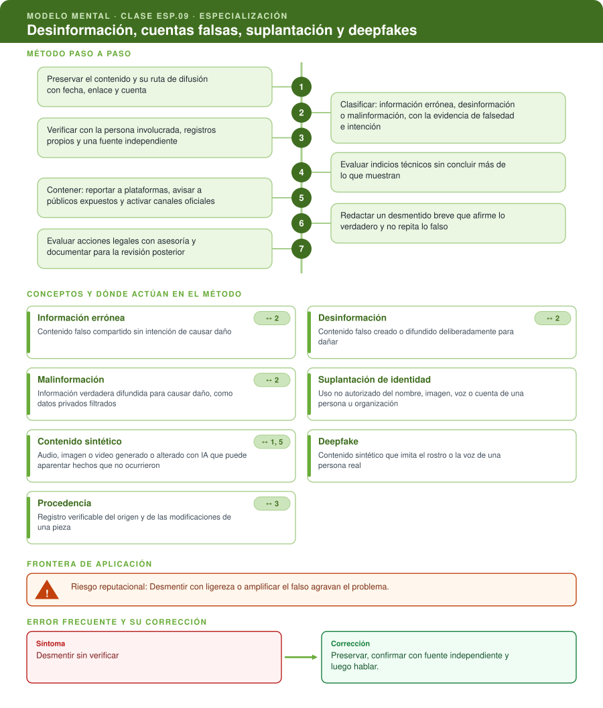

# Clase 09 — Desinformación, cuentas falsas, suplantación y deepfakes

Clase 9 de 10 de la especialización [Reputación, relaciones públicas y comunicación de crisis](README.md). Nivel de dominio: **4 · Dirección**. Dura unos 150 minutos más el laboratorio asociado. Se cursa después de las partes 06 y 12 del currículo y puede leerse antes de la ampliación de la clase anfitriona 21.12.

[⬅ Anterior](clase-08-respuesta-reparacion-y-recuperacion-de-confianza.md) · [Especialización](README.md) · [Siguiente ➡](clase-10-empleados-influencers-comunidades-e-ia-responsable.md)

## 🎯 Propósito

La organización enfrenta hoy contenido falso o manipulado producido a bajo costo: información errónea compartida de buena fe, desinformación deliberada, cuentas que simulan comportamiento orgánico, suplantaciones de identidad y contenido sintético que imita voz o rostro. La respuesta sigue tres planos —verificar, contener y comunicar— y evita dos errores simétricos: ignorar una amenaza real y amplificar una falsedad al desmentirla. La clase también trata el uso responsable de IA como apoyo, con control humano y registro.

## 🧭 Agenda sugerida (150 minutos)

- **0–20 min.** Lee las definiciones y los siete conceptos; comprueba que puedes explicar cada uno con un ejemplo propio.
- **20–60 min.** Estudia los fundamentos y las distinciones: anota qué afirmación de la clase cambiaría una decisión en tu organización.
- **60–90 min.** Sigue el método paso a paso sobre el ejemplo resuelto, sin mirar la resolución, y compara.
- **90–120 min.** Resuelve los tres casos progresivos y justifica cada decisión con la matriz.
- **120–150 min.** Responde las preguntas de comprobación sin volver al texto y empieza el laboratorio 06.

### Resultados de aprendizaje

- distinguir información errónea, desinformación y malinformación por falsedad e intención.
- aplicar un procedimiento de verificación con preservación de evidencia.
- contener una suplantación mediante reporte, aviso a públicos y canales oficiales.
- redactar un desmentido que no repita el contenido falso.
- definir reglas de uso responsable de IA en comunicación y de divulgación de contenido sintético.

## 🧠 Modelo mental

El diagrama se construye con el método y los conceptos de esta clase. Las insignias **↔ n** indican en qué pasos se usa el vocabulario de cada concepto. Descripción textual del método:

1. Preservar el contenido y su ruta de difusión con fecha, enlace y cuenta
2. Clasificar: información errónea, desinformación o malinformación, con la evidencia de falsedad e intención
3. Verificar con la persona involucrada, registros propios y una fuente independiente
4. Evaluar indicios técnicos sin concluir más de lo que muestran
5. Contener: reportar a plataformas, avisar a públicos expuestos y activar canales oficiales
6. Redactar un desmentido breve que afirme lo verdadero y no repita lo falso
7. Evaluar acciones legales con asesoría y documentar para la revisión posterior

## 🔤 Definiciones

**Definición simple.** Antes de desmentir hay que comprobar, y al desmentir hay que decir lo verdadero sin repetir lo falso.

**Definición formal.** Gestión de desinformación y suplantación es el proceso de clasificar contenido problemático según su falsedad e intención de dañar, verificarlo con fuentes independientes, preservar evidencia, contener su difusión y comunicar la corrección con canales oficiales, minimizando la amplificación y respetando los derechos de las personas involucradas.

## 🧩 Conceptos centrales

| Concepto | Definición operacional |
|---|---|
| información errónea | contenido falso compartido sin intención de causar daño |
| desinformación | contenido falso creado o difundido deliberadamente para dañar |
| malinformación | información verdadera difundida para causar daño, como datos privados filtrados |
| suplantación de identidad | uso no autorizado del nombre, imagen, voz o cuenta de una persona u organización |
| contenido sintético | audio, imagen o video generado o alterado con IA que puede aparentar hechos que no ocurrieron |
| deepfake | contenido sintético que imita el rostro o la voz de una persona real |
| procedencia | registro verificable del origen y de las modificaciones de una pieza |

## 📖 Fundamentos

La clasificación guía la respuesta. La información errónea suele corregirse con información clara y amable; quien la compartió probablemente no tenía mala intención. La desinformación exige además contención y análisis del patrón. La malinformación, que es verdadera, no se desmiente: se gestiona protegiendo a las personas y evaluando el daño. Confundir estas categorías lleva a acusar de mala fe a quien se equivocó o a «desmentir» algo que es cierto, con consecuencias graves.

La verificación sigue pasos ordenados. Primero se preserva el contenido y su ruta de difusión: capturas con fecha, enlaces, cuentas, mensajes. Segundo, se contrasta con fuentes independientes: registros propios, la persona supuestamente involucrada, terceros que podrían confirmarlo. Tercero, se evalúan indicios técnicos —inconsistencias de audio, de imagen, de metadatos— con humildad, porque la ausencia de indicios no prueba autenticidad y su presencia no siempre prueba falsedad. Cuarto, se decide qué se puede afirmar y qué no.

Las cuentas falsas y las campañas coordinadas dejan patrones: cuentas recientes, mensajes casi idénticos, ritmos inusuales, redes de interacciones entre sí. Estos patrones son indicios, no pruebas de quién las opera. Se documentan, se reportan a la plataforma con evidencia y no se responde a cada cuenta ni se acusa a un competidor sin prueba. Una acusación infundada transforma a la organización en el origen de un nuevo conflicto.

Ante una suplantación o deepfake se actúa en tres frentes. En contención: reportar a las plataformas, preservar evidencia y avisar a públicos que podrían ser engañados (clientes, empleados, proveedores) por canal oficial. En comunicación: publicar un desmentido breve que afirme lo verdadero, declare cuáles son los canales oficiales y no repita el contenido falso. En derecho: evaluar acciones con asesoría, considerando protección de la imagen, la voz, los datos personales y la propiedad intelectual ([Ley 17.336](https://www.bcn.cl/leychile/navegar?idNorma=28933), [Ley 21.719](https://www.bcn.cl/leychile/navegar?idNorma=1209272)).

El desmentido eficaz es breve y verificable. Comienza por el hecho verdadero («Seguimos operando con normalidad»), declara que el contenido es falso sin reproducirlo, entrega los canales oficiales y comprometen información adicional si la hay. Evita ironía y evita atacar a quien lo difundió. Su objetivo es que quien dudó encuentre una respuesta clara, no ganar una discusión. La repetición del contenido falso, incluso para negarlo, ayuda a su alcance.

El uso de IA en la comunicación exige reglas. Se permite como apoyo de redacción, resumen y simulación de preguntas; se prohíbe para fabricar testimonios, suplantar personas o inventar datos. Todo texto que sale de la organización con ayuda de IA es verificado por una persona responsable que responde por él. Se divulga el uso de contenido sintético cuando una persona razonable podría creer que es real. La organización lleva un registro de qué se generó, con qué datos y quién lo aprobó, y se abstiene de cargar datos personales o reservados en herramientas sin garantías.

### Distinciones que evitan errores

- **Rumor no es desinformación.** el rumor está sin verificar; la desinformación se crea o difunde deliberadamente falsa
- **Desmentir no es amplificar.** se afirma lo verdadero sin repetir lo falso
- **Indicio no es prueba.** un patrón de cuentas nuevas no demuestra quién las controla
- **Malinformación no se desmiente.** es verdadera; se gestiona protegiendo a las personas
- **IA como apoyo no es IA como autor responsable.** la responsabilidad del texto es humana

## 🛠️ Método paso a paso

1. preservar el contenido y su ruta de difusión con fecha, enlace y cuenta.
2. clasificar: información errónea, desinformación o malinformación, con la evidencia de falsedad e intención.
3. verificar con la persona involucrada, registros propios y una fuente independiente.
4. evaluar indicios técnicos sin concluir más de lo que muestran.
5. contener: reportar a plataformas, avisar a públicos expuestos y activar canales oficiales.
6. redactar un desmentido breve que afirme lo verdadero y no repita lo falso.
7. evaluar acciones legales con asesoría y documentar para la revisión posterior.

## ⚖️ Matriz de decisión

La respuesta cambia con la clase de contenido y con la evidencia disponible.

| Situación | Decisión | Condición que la sostiene | Si falla |
|---|---|---|---|
| Información errónea compartida de buena fe | corregir con amabilidad y evidencia | se identifica la fuente del error | se acusa a quien se equivocó |
| Desinformación deliberada con patrón | documentar, reportar, avisar y desmentir sin repetir | hay indicios de coordinación | se acusa sin prueba |
| Suplantación de cuenta o persona | reportar, preservar y publicar canales oficiales | la identidad real puede acreditarse | se amplifica al responder sin verificar |
| Deepfake de audio o video | confirmar con la persona, desmentir con evidencia | existe registro original | se afirma falsedad sin análisis |
| Información verdadera difundida para dañar | proteger a las personas y evaluar acciones | hay datos privados expuestos | se «desmiente» algo cierto |

## 🧮 Ejemplo resuelto

**Enunciado.** Circula en grupos de mensajería un audio atribuido al gerente de Ruta Andina que anuncia el cierre de la empresa y la pérdida de datos. El gerente asegura que nunca lo grabó. Veinte clientes preguntan si es verdad. No se sabe quién lo produjo.

**Resolución.**

1. Preservar: se guarda el archivo, los enlaces de grupos donde circula, fechas y primeras cuentas que lo compartieron.
2. Clasificar: es contenido falso con potencial de dañar; se trata como posible desinformación, sin atribuir autoría.
3. Verificar: el gerente confirma que no lo grabó, se pide análisis técnico y se contrasta con la agenda del supuesto día de grabación.
4. Contener: se reporta a plataformas, se informa a clientes y empleados por canal oficial y se evalúa denuncia con asesoría jurídica.
5. Comunicar: «Seguimos operando con normalidad y tus datos están a salvo. Circula un audio atribuido a nuestro gerente que no corresponde a una grabación suya. Los canales oficiales son estos».

**Resultado.** Se actúa con evidencia y se comunica sin repetir el contenido ni acusar a nadie. Ignorar el audio habría dejado la duda en clientes; desmentir sin verificar habría arriesgado un error; reproducirlo habría ayudado a su difusión.

## 📈 Casos progresivos

### Caso 1 — nivel básico

**Situación.** Un cliente comparte un enlace que afirma que la empresa vende datos. Es una mala interpretación de la política de privacidad.

**Decisión razonada.** Es información errónea. Se responde con claridad, se enlaza la política y se ofrece resolver dudas. No se acusa al cliente ni se corrige con ironía.

### Caso 2 — nivel intermedio

**Situación.** Veinte cuentas creadas esta semana publican el mismo mensaje con una acusación de estafa. Hay un cliente real que dice haber pagado y no recibió servicio.

**Decisión razonada.** Se separa el caso real de las cuentas anómalas. Se resuelve el caso del cliente y se reporta el patrón con evidencia. Se publica una declaración sobre lo verificado y no se acusa a un competidor.

### Caso 3 — nivel avanzado

**Situación.** Aparece un video de un ejecutivo que parece admitir un fraude. Los indicios técnicos son ambiguos y el ejecutivo dice que fue editado.

**Decisión razonada.** No se afirma que sea falso ni verdadero hasta tener análisis independiente. Se comunica que se verifica, se preservan evidencias, se avisa a públicos clave y se coordina con asesoría. Una negación prematura que luego resulta falsa sería devastadora.

## 🧯 Riesgos jurídicos, éticos, comerciales y reputacionales

- **Jurídico.** Suplantación, uso de voz o imagen y tratamiento de datos tienen consecuencias legales ([Ley 17.336](https://www.bcn.cl/leychile/navegar?idNorma=28933), [Ley 21.719](https://www.bcn.cl/leychile/navegar?idNorma=1209272)); las acusaciones sin prueba pueden generar acciones contra la organización.
- **Ético.** No se fabrica contenido falso, ni se usan cuentas simuladas, ni se responde con engaños; se divulga el contenido sintético.
- **Comercial.** Una campaña de desinformación puede afectar ventas; la inversión en canales oficiales claros reduce el daño.
- **Reputacional.** Desmentir con ligereza o amplificar el falso agravan el problema.

## 🔬 Laboratorio

El laboratorio asociado es [Verificación de desinformación y política de redes](labs/lab-06-verificacion-de-desinformacion-y-politica-de-redes.md). Entrega: Registro de verificación, desmentido y política de redes de una página.

## ✍️ Ejercicios

1. Clasifica seis contenidos sintéticos como información errónea, desinformación o malinformación y justifica con falsedad e intención.
2. Elabora un procedimiento de verificación de cinco pasos para un audio sospechoso.
3. Redacta un desmentido de 60 palabras que no repita el contenido falso.
4. Diseña un registro de uso de IA en comunicación: qué se permite, qué se prohíbe y quién aprueba.
5. Identifica tres indicios de patrón coordinado y tres razones por las que no prueban autoría.
6. Define cuáles son los canales oficiales de una organización y cómo se comunican antes de una crisis.

## ⚠️ Errores habituales

- **Desmentir sin verificar.** Preservar, confirmar con fuente independiente y luego hablar.
- **Repetir el contenido falso.** Afirmar lo verdadero y remitir a canales oficiales.
- **Acusar a un competidor.** Documentar indicios y reportar; atribuir sólo con prueba.
- **Negar un material que puede ser auténtico.** Declarar que se verifica y comunicar el resultado.
- **Usar IA sin control humano.** Una persona verifica y responde por cada texto.

## ✅ Evaluación

**Rúbrica.**

| Criterio | Peso | Evidencia de logro |
|---|---|---|
| Clasificación | 20 % | justifica con falsedad e intención |
| Verificación y evidencia | 30 % | preserva, contrasta y reconoce límites |
| Contención y desmentido | 30 % | reporta, avisa y no amplifica |
| Reglas de IA | 20 % | usos permitidos, prohibidos y registro |

**Preguntas de comprobación.**

1. ¿Cómo se distinguen información errónea, desinformación y malinformación?
2. ¿Por qué la ausencia de indicios técnicos no prueba autenticidad?
3. ¿Qué debe y qué no debe contener un desmentido?
4. ¿Qué reglas básicas gobiernan el uso de IA en comunicación?
5. ¿Por qué un patrón de cuentas nuevas no permite acusar a una persona o empresa?

## 🇨🇱 Contexto chileno

La norma manda sobre el material pedagógico. Antes de aplicar cualquier recomendación en una operación real, contrasta su texto vigente:

- [Ley 17.336](https://www.bcn.cl/leychile/navegar?idNorma=28933) — *Propiedad intelectual* (Ministerio de Educación Pública): derechos de autor sobre dibujos, personajes y demás obras originales.
- [Ley 21.719](https://www.bcn.cl/leychile/navegar?idNorma=1209272) — *Regula la protección y el tratamiento de los datos personales y crea la Agencia de Protección de Datos Personales* (Ministerio Secretaría General de la Presidencia): tratamiento de datos personales, bases de licitud y derechos del titular.
- [Ley 19.628](https://www.bcn.cl/leychile/navegar?idNorma=141599) — *Sobre protección de la vida privada* (Ministerio Secretaría General de la Presidencia): régimen previo de datos personales, todavía aplicable en lo no derogado.

## 🧭 Síntesis y puente con otras clases

La amenaza de la falsedad no sustituye a la de los errores propios; se suma a ella. Esta clase exige disciplina: preservar, clasificar, verificar, contener y comunicar sin amplificar. Se articula con la escucha (clase 05), que detecta el patrón; con el protocolo (clase 07), que define quién decide; y con la clase 10, que gobierna el uso responsable de IA dentro de la organización. La regla de fondo es la humildad epistémica: afirmar solamente lo que la evidencia sostiene, también cuando la evidencia apunta a que la organización es la víctima. Eso incluye reconocer lo que no se logró verificar: un desmentido que dice «no pudimos confirmar el origen del audio, pero confirmamos que el gerente no lo grabó» es más creíble que uno que afirma saberlo todo, y deja abierta la corrección si aparece información nueva.

## 📗 Referencias verificables

- Claire Wardle y Hossein Derakhshan — [*Information Disorder: Toward an Interdisciplinary Framework for Research and Policy Making*](https://rm.coe.int/information-disorder-toward-an-interdisciplinary-framework-for-researc/168076277c) (2017) · fuente primaria — **aporta a esta clase:** información errónea, desinformación y malinformación se distinguen por falsedad e intención de dañar, y se analizan por fase, elemento y agente. **Dónde buscarlo:** el apartado de definiciones y el marco de fases y elementos. **Acceso:** gratis.
- Robert B. Cialdini — [*Influence: The Psychology of Persuasion, New and Expanded*](https://openlibrary.org/isbn/9780062937650) (2021) · ISBN 9780062937650 — **aporta a esta clase:** la prueba social funciona por similitud del referente, no por cantidad. **Dónde buscarlo:** el capítulo sobre aprobación social. **Acceso:** comprar o biblioteca.
- ISO — *ISO 31000: Gestión del riesgo* (2018) · fuente primaria — **aporta a esta clase:** el riesgo residual aceptado de forma explícita y documentada. **Dónde buscarlo:** la cláusula sobre tratamiento del riesgo. **Acceso:** de pago.

> Las obras se citan, no se reproducen. Si la idea no está donde se indica, corresponde reportarlo como error del material. No se citan números de página porque cambian entre ediciones.

[⬅ Anterior](clase-08-respuesta-reparacion-y-recuperacion-de-confianza.md) · [Especialización](README.md) · [Siguiente ➡](clase-10-empleados-influencers-comunidades-e-ia-responsable.md)
