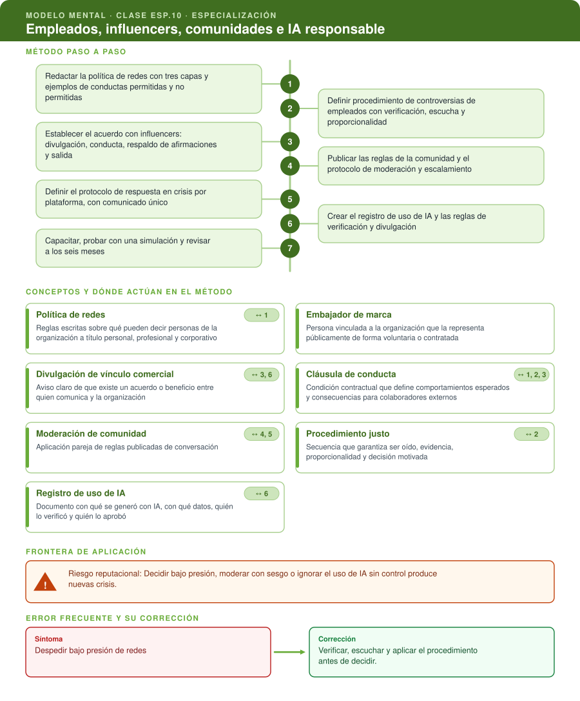

# Clase 10 — Empleados, influencers, comunidades e IA responsable

Clase 10 de 10 de la especialización [Reputación, relaciones públicas y comunicación de crisis](README.md). Nivel de dominio: **5 · Criterio experto**. Dura unos 150 minutos más el laboratorio asociado. Se cursa después de las partes 06 y 12 del currículo y puede leerse antes de la ampliación de la clase anfitriona 12.07.

[⬅ Anterior](clase-09-desinformacion-suplantacion-y-deepfakes.md) · [Especialización](README.md)

## 🎯 Propósito

La reputación de una organización ya no se juega sólo en su comunicación oficial: la construyen sus empleados, sus embajadores, sus influencers contratados, sus comunidades y, cada vez más, las herramientas de IA que usa. Esta clase integra marca empleadora, community management y gobierno de IA en un marco coherente: reglas claras y públicas, procedimientos justos, divulgación de vínculos comerciales, protocolos de respuesta por plataforma y revisión humana. Su límite es doble: no se invade la vida privada de las personas ni se deja a la organización sin protección frente a conductas que la dañan.

## 🧭 Agenda sugerida (150 minutos)

- **0–20 min.** Lee las definiciones y los siete conceptos; comprueba que puedes explicar cada uno con un ejemplo propio.
- **20–60 min.** Estudia los fundamentos y las distinciones: anota qué afirmación de la clase cambiaría una decisión en tu organización.
- **60–90 min.** Sigue el método paso a paso sobre el ejemplo resuelto, sin mirar la resolución, y compara.
- **90–120 min.** Resuelve los tres casos progresivos y justifica cada decisión con la matriz.
- **120–150 min.** Responde las preguntas de comprobación sin volver al texto y empieza el laboratorio 06.

### Resultados de aprendizaje

- diseñar una política de redes que distinga lo personal, lo profesional y lo corporativo.
- gestionar una controversia de empleado con procedimiento justo y proporcional.
- contratar y supervisar influencers con divulgación, cláusula de conducta y plan de salida.
- operar una comunidad con reglas publicadas, moderación pareja y protocolo de escalamiento.
- gobernar el uso de IA en comunicación con registro, verificación y divulgación.

## 🧠 Modelo mental

El diagrama se construye con el método y los conceptos de esta clase. Las insignias **↔ n** indican en qué pasos se usa el vocabulario de cada concepto. Descripción textual del método:

1. Redactar la política de redes con tres capas y ejemplos de conductas permitidas y no permitidas
2. Definir procedimiento de controversias de empleados con verificación, escucha y proporcionalidad
3. Establecer el acuerdo con influencers: divulgación, conducta, respaldo de afirmaciones y salida
4. Publicar las reglas de la comunidad y el protocolo de moderación y escalamiento
5. Definir el protocolo de respuesta en crisis por plataforma, con comunicado único
6. Crear el registro de uso de IA y las reglas de verificación y divulgación
7. Capacitar, probar con una simulación y revisar a los seis meses

## 🔤 Definiciones

**Definición simple.** Cada persona que habla de tu empresa influye en su reputación; gobernar esa voz es poner reglas claras, ser justo con las personas y estar preparado cuando algo sale mal.

**Definición formal.** Gobierno de la voz organizacional es el conjunto de políticas, procedimientos y controles que delimitan quién puede comunicar en nombre de la organización o asociado a ella, bajo qué condiciones, con qué divulgación y con qué respuesta ante conductas que la afectan, respetando los derechos de las personas y la transparencia frente a los públicos.

## 🧩 Conceptos centrales

| Concepto | Definición operacional |
|---|---|
| política de redes | reglas escritas sobre qué pueden decir personas de la organización a título personal, profesional y corporativo |
| embajador de marca | persona vinculada a la organización que la representa públicamente de forma voluntaria o contratada |
| divulgación de vínculo comercial | aviso claro de que existe un acuerdo o beneficio entre quien comunica y la organización |
| cláusula de conducta | condición contractual que define comportamientos esperados y consecuencias para colaboradores externos |
| moderación de comunidad | aplicación pareja de reglas publicadas de conversación |
| procedimiento justo | secuencia que garantiza ser oído, evidencia, proporcionalidad y decisión motivada |
| registro de uso de IA | documento con qué se generó con IA, con qué datos, quién lo verificó y quién lo aprobó |

## 📖 Fundamentos

La política de redes tiene tres capas. A título personal, la persona opina sin invocar a la organización y respeta confidencialidad y datos de terceros. A título profesional, comparte conocimiento propio de su rol con las salvaguardas que la organización defina. A título corporativo, sólo habla quien está autorizado y con mensajes aprobados. La política debe ser escrita, conocida, proporcional y coherente con el derecho laboral, sin pretender controlar la vida privada. Una política que prohíbe todo se incumple y una que no dice nada deja a la organización sin base cuando surge un problema.

Cuando un empleado produce una controversia, la reacción pública rápida suele ser desproporcionada. Se verifica el hecho (¿la captura es auténtica y completa?), se identifica el marco aplicable (¿habló a título personal o invocó a la empresa?, ¿hay afectación de terceros o de la ley?), se respeta el procedimiento laboral y se escucha a la persona antes de resolver ([Código del Trabajo](https://www.bcn.cl/leychile/navegar?idNorma=207436)). Entretanto, la organización comunica que revisa el caso y protege a quienes fueron afectados, sin anunciar sanciones que aún no se han decidido.

Contratar influencers expone a la organización a la conducta de otra persona. Se evalúa su historial y su audiencia con evidencia, se firma un acuerdo con divulgación obligatoria del vínculo comercial, cláusula de conducta, restricciones sobre afirmaciones no respaldadas, derecho de revisión de contenido propio y plan de salida. Las afirmaciones sobre productos hechas por un influencer comprometen a la marca como si fueran propias, por lo que se aplican las mismas exigencias de respaldo ([Ley 19.496](https://www.bcn.cl/leychile/navegar?idNorma=61438)). No se pagan reseñas simuladas ni se ofrece compensación condicionada a una opinión favorable.

La comunidad en línea es un patrimonio que se gobierna con reglas publicadas, moderación pareja, protocolo de escalamiento y trato respetuoso. Se distingue crítica legítima, abuso y spam; se responde a la primera, se aplica la regla al segundo y se bloquea el tercero. Las decisiones de moderación se registran y se aplican igual a todos, incluidos los favorables. En una crisis, el community manager sigue el protocolo: un comunicado único, formato por plataforma, traslado de datos personales a canal privado y suspensión de contenido programado.

La marca empleadora se juega en la coherencia entre lo que se promete y lo que se vive. Se publican condiciones concretas (rango salarial, proceso, tiempos), se escucha a candidatos y extrabajadores, se responde con respeto a críticas y se corrige la práctica cuando el reclamo es fundado. Las reseñas de empleo pueden contener errores y también verdades incómodas; la respuesta pública se limita a lo verificable y respeta la confidencialidad de las personas involucradas.

El gobierno de IA en comunicación combina cuatro elementos: usos permitidos (redacción asistida, resumen, simulación de preguntas), usos prohibidos (testimonios inventados, suplantación, decisiones sin revisión humana), verificación obligatoria por una persona que responde por el contenido, y registro de lo generado con sus datos de entrada. Se divulga el uso de contenido sintético cuando podría confundirse con real y se evita cargar datos personales o reservados en herramientas sin garantías. La política se revisa periódicamente porque la tecnología cambia más rápido que los reglamentos.

### Distinciones que evitan errores

- **Política de redes no es censura.** ordena responsabilidades y límites sin controlar la vida privada
- **Influencer no es empleado.** se rige por un acuerdo propio y necesita cláusulas y divulgación
- **Moderar no es borrar críticas.** se aplican reglas públicas y parejas, no gusto de quien modera
- **Sanción no es respuesta pública.** la organización puede comunicar que revisa sin anunciar resultados prematuros
- **IA no es excusa.** la responsabilidad por lo publicado sigue siendo humana

## 🛠️ Método paso a paso

1. redactar la política de redes con tres capas y ejemplos de conductas permitidas y no permitidas.
2. definir procedimiento de controversias de empleados con verificación, escucha y proporcionalidad.
3. establecer el acuerdo con influencers: divulgación, conducta, respaldo de afirmaciones y salida.
4. publicar las reglas de la comunidad y el protocolo de moderación y escalamiento.
5. definir el protocolo de respuesta en crisis por plataforma, con comunicado único.
6. crear el registro de uso de IA y las reglas de verificación y divulgación.
7. capacitar, probar con una simulación y revisar a los seis meses.

## ⚖️ Matriz de decisión

La respuesta a una controversia depende del hecho, del marco aplicable y de la proporcionalidad.

| Situación | Decisión | Condición que la sostiene | Si falla |
|---|---|---|---|
| Comentario personal ofensivo de un empleado que menciona su cargo | verificar, escuchar, aplicar procedimiento y comunicar que se revisa | hay hecho verificable y marco laboral | decisión desproporcionada bajo presión |
| Influencer contratado incumple divulgación | corregir de inmediato, aplicar cláusula y aclarar públicamente | existe acuerdo con la cláusula | se percibe como publicidad oculta |
| Crítica legítima en la comunidad | responder y resolver, no borrar | hay hecho y regla pareja | se acusa de censura |
| Comentario abusivo o spam | aplicar la regla publicada y registrar | la regla es pública | se interpreta como arbitrariedad |
| Contenido generado con IA sin revisión | retirar, corregir y aplicar registro | hay un responsable humano | se publica información falsa |

## 🧮 Ejemplo resuelto

**Enunciado.** Una ejecutiva de ventas de Ruta Andina publicó en su cuenta personal, que menciona su cargo, un comentario ofensivo sobre clientes de un rubro. Un influencer asociado compartió la captura y exige su despido. El comentario fue borrado a las tres horas. Dos clientes piden explicaciones.

**Resolución.**

1. Verificar: la captura es auténtica, la cuenta menciona el cargo y no hay contexto adicional que cambie su sentido.
2. Marco aplicable: la política de redes establece que quien menciona su cargo representa la imagen de la empresa; el procedimiento laboral exige escuchar a la persona antes de decidir.
3. Comunicación inmediata: reconocer que el comentario no refleja los valores de la empresa, informar que se revisa conforme al procedimiento y contactar a los clientes que lo pidieron.
4. Influencer: conversar en privado, recordar la cláusula de conducta y evitar entrar en el debate público sobre la sanción.
5. Aprendizaje: publicar una política de redes actualizada, capacitar y revisar las cláusulas con colaboradores externos.

**Resultado.** La respuesta es proporcional y respeta el procedimiento: no se despide por presión de redes ni se defiende el comentario. Se protege a los clientes ofendidos, se mantiene la relación con el influencer sin concederle control sobre decisiones laborales y se cambia el sistema para que el caso no se repita.

## 📈 Casos progresivos

### Caso 1 — nivel básico

**Situación.** Un empleado publica una foto de la oficina con información de un cliente visible en una pantalla.

**Decisión razonada.** Se pide retirar la publicación, se evalúa el daño al cliente, se capacita y se informa al cliente si sus datos quedaron expuestos. No se sanciona automáticamente: se aplica el procedimiento.

### Caso 2 — nivel intermedio

**Situación.** Un influencer contratado recomienda un producto con una afirmación de resultado que la empresa no puede respaldar.

**Decisión razonada.** Se corrige de inmediato, se pide editar la publicación, se aplica la cláusula y se revisa si hay clientes que compraron por esa afirmación. La marca responde como propia.

### Caso 3 — nivel avanzado

**Situación.** Una herramienta de IA genera una respuesta a un cliente con un compromiso de reembolso que la empresa no ofrece. Hay una captura difundida.

**Decisión razonada.** Se reconoce el error, se decide caso a caso si se honra por su efecto sobre la expectativa del cliente, se retira la automatización sin revisión humana y se actualiza el registro de uso de IA. Defender «fue la máquina» no es una respuesta.

## 🧯 Riesgos jurídicos, éticos, comerciales y reputacionales

- **Jurídico.** La relación laboral y los procedimientos disciplinarios se rigen por el derecho del trabajo ([Código del Trabajo](https://www.bcn.cl/leychile/navegar?idNorma=207436)); los datos personales de empleados y clientes se tratan según la ley ([Ley 21.719](https://www.bcn.cl/leychile/navegar?idNorma=1209272), [Ley 19.628](https://www.bcn.cl/leychile/navegar?idNorma=141599)); las afirmaciones comerciales de influencers se someten a la ley de consumo ([Ley 19.496](https://www.bcn.cl/leychile/navegar?idNorma=61438)).
- **Ético.** No se vigila la vida privada ni se obliga a la persona a ser «embajadora»; la divulgación de vínculos comerciales es obligatoria.
- **Comercial.** Depender de un influencer o de una comunidad sin plan de salida concentra riesgo.
- **Reputacional.** Decidir bajo presión, moderar con sesgo o ignorar el uso de IA sin control produce nuevas crisis.

## 🔬 Laboratorio

El laboratorio asociado es [Verificación de desinformación y política de redes](labs/lab-06-verificacion-de-desinformacion-y-politica-de-redes.md). Entrega: Registro de verificación, desmentido y política de redes de una página.

## ✍️ Ejercicios

1. Redacta una política de redes de una página con las tres capas y cinco ejemplos.
2. Diseña el procedimiento de revisión de una controversia de empleado con pasos, plazos y derechos de la persona.
3. Elabora un acuerdo tipo con influencer con divulgación, cláusula de conducta, respaldo de afirmaciones y salida.
4. Escribe las reglas públicas de una comunidad y un protocolo de escalamiento a tres niveles.
5. Crea un registro de uso de IA con campos, responsables y reglas de divulgación.
6. Simula una crisis en tres plataformas y define el comunicado único y el formato por plataforma.

## ⚠️ Errores habituales

- **Despedir bajo presión de redes.** Verificar, escuchar y aplicar el procedimiento antes de decidir.
- **Contratar influencers sin cláusulas.** Acuerdo escrito con divulgación, conducta y salida.
- **Moderar con criterio personal.** Reglas públicas, aplicadas igual a todos.
- **Dejar que la IA responda sin supervisión.** Persona responsable, registro y verificación.
- **Prohibir hablar en redes.** Delimitar alcance y capacitar; la prohibición total se incumple.

## ✅ Evaluación

**Rúbrica.**

| Criterio | Peso | Evidencia de logro |
|---|---|---|
| Política y procedimiento | 30 % | tres capas, procedimiento justo y proporcionalidad |
| Influencers y comunidad | 25 % | divulgación, cláusulas y moderación pareja |
| Gobierno de IA | 25 % | usos, verificación, registro y divulgación |
| Caso integrador | 20 % | respuesta coherente a la simulación con revisión posterior |

**Preguntas de comprobación.**

1. ¿Qué tres capas debe distinguir una política de redes y por qué?
2. ¿Qué pasos sigue una organización ante una controversia de un empleado antes de anunciar medidas?
3. ¿Qué debe incluir un acuerdo con un influencer para proteger a la marca y al público?
4. ¿Qué distingue moderar de borrar críticas?
5. ¿Qué reglas básicas gobiernan el uso de IA en comunicación?

## 🇨🇱 Contexto chileno

La norma manda sobre el material pedagógico. Antes de aplicar cualquier recomendación en una operación real, contrasta su texto vigente:

- [Código del Trabajo](https://www.bcn.cl/leychile/navegar?idNorma=207436) — *Fija el texto refundido, coordinado y sistematizado del Código del Trabajo* (Ministerio del Trabajo y Previsión Social): deber de protección eficaz de la vida y salud de quienes trabajan.
- [Ley 21.719](https://www.bcn.cl/leychile/navegar?idNorma=1209272) — *Regula la protección y el tratamiento de los datos personales y crea la Agencia de Protección de Datos Personales* (Ministerio Secretaría General de la Presidencia): tratamiento de datos personales, bases de licitud y derechos del titular.
- [Ley 19.628](https://www.bcn.cl/leychile/navegar?idNorma=141599) — *Sobre protección de la vida privada* (Ministerio Secretaría General de la Presidencia): régimen previo de datos personales, todavía aplicable en lo no derogado.
- [Ley 19.496](https://www.bcn.cl/leychile/navegar?idNorma=61438) — *Establece normas sobre protección de los derechos de los consumidores* (Ministerio de Economía, Fomento y Reconstrucción): derechos del consumidor, publicidad engañosa, información y garantías.

## 🧭 Síntesis y puente con otras clases

La clase final integra a las personas que hablan por, con o sobre la organización —empleados, embajadores, influencers, comunidades— y a las herramientas de IA que producen contenido. Su criterio común es el gobierno proporcional: reglas escritas, procedimientos justos, divulgación y responsabilidad humana. Cierra la especialización porque reúne los problemas de todas las clases anteriores en el lugar donde la mayoría de las crisis se originan: la conducta cotidiana de quienes representan a la organización. La evaluación integradora pide demostrarlo con un caso propio documentado.

## 📗 Referencias verificables

- Tim Ambler y Simon Barrow — [*The Employer Brand (Journal of Brand Management)*](https://doi.org/10.1057/bm.1996.42) (1996) · DOI 10.1057/bm.1996.42 — **aporta a esta clase:** la marca empleadora como paquete de beneficios funcionales, económicos y psicológicos que ofrece el empleo y se identifica con la empresa empleadora. **Dónde buscarlo:** la sección donde el artículo define la marca empleadora. **Acceso:** acceso limitado.
- Dorie Clark — [*Reinventing You: Define Your Brand, Imagine Your Future*](https://openlibrary.org/isbn/9781422144138) (2013) · ISBN 9781422144138 — **aporta a esta clase:** la marca personal se define con una promesa y se sostiene con evidencia pública repetible por otras personas, y se reposiciona por etapas. **Dónde buscarlo:** las secciones sobre definir la marca personal y construir la reputación. **Acceso:** comprar o biblioteca.
- Seth Godin — [*This Is Marketing*](https://openlibrary.org/isbn/9780525540830) (2018) · ISBN 9780525540830 — **aporta a esta clase:** el público mínimo viable: servir a los pocos que sí quieren esto. **Dónde buscarlo:** los capítulos sobre el público mínimo viable. **Acceso:** comprar o biblioteca.

> Las obras se citan, no se reproducen. Si la idea no está donde se indica, corresponde reportarlo como error del material. No se citan números de página porque cambian entre ediciones.

[⬅ Anterior](clase-09-desinformacion-suplantacion-y-deepfakes.md) · [Especialización](README.md)
